# VOLUMEN 7: SISTEMA CANÓNICO DE DISEÑO UI/UX Y TEATRO MAP-FIRST
**Documento Canónico Unificado:** `07_MASTER_UI_UX_WAR_ROOM.md`

**Proyecto:** *DRONEPUNK 0.0.1*  
**Versión de Arquitectura:** 0.0.1 (*Map-First C4ISR & 4-Scale Unified Inspector — Advance Wars meets Paradox / Persona 5*)  
**Estado:** Producción Certificada (Arquitectura Modular de 4 Dominios + Shared Verificada)  
**Invariante Crítica:** **CERO modificaciones destructivas a la lógica de combate (1–100 HP enteros, derrota a 0 tropas), motores matemáticos, contratos de Supabase ni firmas públicas de `WarLobbyHubProps`. Cumplimiento estricto de los 7 Pilares Canónicos (Almacén Físico de 16 Chasis Militares como munición descartable forjada).**

---

## 1. Visión Arquitectónica: Menú Único 100% Mapa-Primero (Map-First C4ISR)

La arquitectura transforma `src/domains/world/components/WarLobbyHub.tsx` y su articulación con `src/App.tsx` y `src/domains/tactics/components/CombatTheaterView.tsx` erradicando por completo la pantalla intermedia separada (`TacticalC4ISRBaseDiorama`): **al iniciar, el Mapa WebGL Zero-Raster (`src/domains/world/components/TacticalWorldMap.tsx`) ES el menú principal y lienzo único al 100% del viewport (`100vw × 100vh`)**:

1. **Persistencia Espacial Total (Zero-Unmount Map-First Shell):** `TacticalWorldMap.tsx` permanece montado al 100% sin transiciones a pantallas negras ni salas aisladas. Las 6 estaciones de metajuego (**TIENDA, INDUSTRIA, ARMERÍA, P2P, ALIANZA, DOCTRINA**) ubicadas en el dock inferior derecho (`src/domains/world/components/RightActionDock.tsx`) despliegan terminales diegéticas superpuestas (`backdrop-blur-md`) sobre el teatro cartográfico sin perder estado ni temporizadores (`Volver al Mapa [ESC]`).
2. **Maquetación Perimetral Limpia y Jerárquica:**
   - **Header Superior Persistente (`DualResourceHeader.tsx`):** Franja compacta dark-glass (`#0E100C/90`, `h-12`) con rango/nivel, Barra Ghost EXP, accesos de país, `EC`, Acero, Tierras Raras, `tech_scrap`, Fondos `$G`, temporizador de ciclo y conmutador del inspector derecho.
   - **Rail Izquierdo Desplegable (`LeftCollapsibleRail.tsx`) + Blindaje de Bark (`CommanderBarkWidget.tsx`):** Rail superior/medio izquierdo (`CAPAS`, `FEED`, `RADIO`, `AJUSTES`) que deja la esquina inferior izquierda **100% despejada para Mayor Stella / Bark Engine** (`CommanderBarkWidget.tsx` conectado al `barkEngine` para canalizar tanto clics de selector como alertas de asedio).
   - **Inspector Derecho Unificado de 4 Escalas Geográficas (`UnifiedRegionInspector.tsx` + `mapSelectionTypes.ts`):** Panel colapsable en el lateral derecho (`top-14 right-3 bottom-16`, `~356–376px`) anclado por encima de `RightActionDock` con breadcrumb navegable `País > Estado > Municipio > Celda [sx,sy]` y 4 pestañas (`RESUMEN`, `GOBIERNO`, `ECONOMÍA`, `OPERACIONES`).
3. **Geometría Híbrida & Tinta Sólida (`45° Armor` + `14px/4px Comic Asymmetry`):** Se mantienen las sombras duras offset (`4px 4px 0px #0A0B08`), contornos de tinta `#0A0B08`, tipografía tabular `tabular-nums` y sellos pop-art rotados en el módulo narrativo.

---

## 2. Sistema Unificado de Tokens Visuales (`src/index.css` & `index.html`)

### 2.1. Tipografía Expresiva y Tabular (`index.html`)
Se cargarán desde Google Fonts tres familias con personalidad militar y de novela gráfica:
- **Display / Titulares de Impacto y Sellos (`--font-display`):** `'Chakra Petch'` (700, 800, Italics) — Geometría mecanizada con cortes angulares ideales para encabezados C4ISR y onomatopeyas.
- **UI Táctica y Narrativa (`--font-sans`):** `'Space Grotesk'` (500, 700) — Lectura ultraclara para expedientes, fichas de unidades físicas del hangar (Almacén Físico de 16 Chasis) y bocadillos del Bark Engine.
- **Telemetría, Coordenadas y Odómetros (`--font-mono`):** `'JetBrains Mono'` (600, 800) con `font-variant-numeric: tabular-nums` obligatorio en todo contador o reloj.

### 2.2. Paleta Cromática Canónica (70-20-10 + Heráldica de Facciones)

| Categoría | Token CSS | Valor Hex | Uso Estricto en la Interfaz |
| :--- | :--- | :---: | :--- |
| **Núcleo Blindado (70%)** | `--color-bunker-void` | `#161712` | Foso de aplicación, sombras internas y bahía profunda. |
| | `--color-ink-black` | `#0A0B08` | Contornos de tinta cómic (`2px–3px`) y sombras duras offset (`4px 4px 0px`). |
| | `--color-armor-base` | `#2B2C24` | Chasis principal de paneles, tarjetas de unidad y consolas. |
| | `--color-military-olive` | `#46521F` | Cubiertas secundarias, módulos de apoyo y calzadas. |
| | `--color-metal-edge` | `#7B8A4A` | Biseles estructurales y bordes pasivos. |
| | `--color-olive- high` | `#A9B87A` | **Nuevo token accesible (WCAG AA `4.9:1` sobre `#2B2C24`)** para subtítulos y etiquetas. |
| **Papel Táctico & Datos (20%)** | `--color-data-cream` | `#F2E8D5` | Tipografía primaria, fondo de dossieres de misión, bocadillos cómic y *Ghost Bars*. |
| **Acentos de Combate (10%)** | `--color-rust-alert` | `#C46A3A` | CTA `¡ORDEN DE COMBATE!`, alertas DEFCON y daño balístico. |
| | `--color-amber-command` | `#F59E0B` | Recompensas de Oro, estrellas de rango/COP y botones de suministro. |
| | `--color-crt-radar` | `#00FF66` | **USO RESTRINGIDO:** Únicamente radares polares, barrido C4ISR y LED `ONLINE`. |
| **5 Facciones Heráldicas** | `--color-fac-orange` | `#E65100` / `#F59E0B` | **Orange Star / Iron Vanguard** (Stella, Andy, Max, Sami). |
| | `--color-fac-blue` | `#1D4ED8` / `#60A5FA` | **Blue Moon / Frost Legion** (Colin, Volkov, Grit). |
| | `--color-fac-green` | `#15803D` / `#4ADE80` | **Green Earth / Emerald Guard** (Eagle, Vance). |
| | `--color-fac-yellow` | `#D97706` / `#FDE047` | **Yellow Comet / Solar Shogunate** (Kanbei, Sonja). |
| | `--color-fac-black` | `#4C1D95` / `#EF4444` | **Black Hole / Shadow Syndicate** (Hawke, Sturm). |

### 2.3. Primitivas Geométricas y de Física (`src/index.css`)

```css
@import "tailwindcss";

:root {
  --ease-spring: cubic-bezier(0.34, 1.56, 0.64, 1);
  --ease-out-expo: cubic-bezier(0.22, 1, 0.36, 1);

  --color-bunker-void: #161712;
  --color-ink-black: #0A0B08;
  --color-armor-base: #2B2C24;
  --color-military-olive: #46521F;
  --color-metal-edge: #7B8A4A;
  --color-olive-high: #A9B87A;
  --color-rust-alert: #C46A3A;
  --color-data-cream: #F2E8D5;
  --color-crt-radar: #00FF66;
}

/* 1. Tarjeta Táctica Asimétrica con Tinta Sólida (Sin recorte de sombra) */
.tactical-comic-card {
  background-color: var(--color-armor-base);
  border: 2px solid var(--color-ink-black);
  outline: 1px solid rgba(123, 138, 74, 0.45);
  outline-offset: -3px;
  border-radius: 14px 4px 14px 4px;
  box-shadow: 4px 4px 0px var(--color-ink-black);
  transition: transform 0.2s var(--ease-spring), box-shadow 0.2s var(--ease-spring), border-color 0.15s ease;
}
.tactical-comic-card:hover {
  transform: translateY(-2px) scale(1.01);
  box-shadow: 6px 6px 0px var(--color-ink-black);
}

/* 2. Chasis Blindado Achaflanado a 45° con Drop-Shadow Externo */
.tactical-chamfer-wrap {
  filter: drop-shadow(4px 4px 0px #0A0B08);
}
.tactical-chamfer-box {
  clip-path: polygon(
    10px 0, calc(100% - 10px) 0,
    100% 10px, 100% calc(100% - 10px),
    calc(100% - 10px) 100%, 10px 100%,
    0 calc(100% - 10px), 0 10px
  );
}

/* 3. Botón de Mando Pesado 3D con Squash & Stretch (<16ms) */
.tactical-btn-heavy {
  background: linear-gradient(180deg, #df7b48 0%, #C46A3A 60%, #873612 100%);
  color: var(--color-data-cream);
  border: 2px solid var(--color-data-cream);
  border-bottom: 5px solid #5a1e05;
  border-radius: 14px 4px 14px 4px;
  box-shadow: 4px 4px 0px var(--color-ink-black);
  transition: transform 0.16s var(--ease-spring), border-bottom-width 0.06s ease, filter 0.12s ease;
  will-change: transform;
}
.tactical-btn-heavy:hover {
  transform: translateY(-2px) scale(1.03);
  filter: brightness(1.1);
}
.tactical-btn-heavy:active {
  transform: translateY(3px) scale(1.08, 0.90);
  border-bottom-width: 2px;
  box-shadow: 1px 1px 0px var(--color-ink-black);
}

/* 4. Trama de Puntos Ben-Day (Novela Gráfica) */
.ben-day-overlay {
  background-image: radial-gradient(rgba(123, 138, 74, 0.28) 18%, transparent 19%);
  background-size: 8px 8px;
}
.ben-day-cream {
  background-color: #F2E8D5;
  background-image: radial-gradient(rgba(196, 106, 58, 0.18) 18%, transparent 19%);
  background-size: 8px 8px;
}

/* 5. Barras de Doble Capa (Ghost Drain / Surge Trail) */
.bar-ghost-trail {
  transition: width 0.55s var(--ease-out-expo) 0.22s;
}
.bar-fill-spring {
  transition: width 0.15s var(--ease-spring);
}
```

---

## 3. Wireframes Esquemáticos por Zona (`100vh × 100vw` 100% Map-First, Zero Overlap)

### 3.1. Distribución Perimetral Unificada (`WarLobbyHub.tsx`)

```
+======================================================================================================+
| ZONA 1: HEADER SUPERIOR PERSISTENTE (DualResourceHeader, h-12 / 48px fijo, z-30)                     |
| [NVL + EXP] [País] | [⚡4,850 EC | 🔩Acero | 💎Tierras Raras | 🔧Scrap | 💰$G | ⏱️05:00] | [Toggle]|
+======================================================================================================+
|                                                                                                      |
| [≡ C4ISR • Zx.x] [ESCALA]        [OPENPLACE WEBGL • ZOOM]        +---------------------------------+ |
|  LeftCollapsibleRail (top-left)                                  | UNIFIED REGION INSPECTOR (Der)  | |
|  • CAPAS (4 escalas)                                             | [Escala País/Estado/Mun/Celda]  | |
|  • FEED (Alice live)                                             | País > Estado > Mun > Celda     | |
|  • RADIO (Aliados)            LIENZO ÚNICO WEBGL 2.0             | [RESUMEN|GOBIERNO|ECON|OPS]      | |
|  • AJUSTES (Audio/CRT)         TacticalWorldMap.tsx              | • País: PIB, Capital, Edictos   | |
|                                    100vw × 100vh                 | • Estado: De Jure/Facto, TCP    | |
|                                                                  | • Mun: Cabecera, Feudos, Red    | |
| +-----------------------------+                                  | • Celda 20x20: DESPLEGAR/CONST. | |
| | ★ MAYOR STELLA // BARK      |                                  +---------------------------------+ |
| | CommanderBarkWidget         |                                  |  RIGHT ACTION DOCK (bottom-3)   | |
| | (Bottom-Left Reservado)     |                                  | [TIENDA][IND][ARM][P2P][ALZ][DOC]|
+======================================================================================================+
```

### 3.2. Detalle de las 5 Zonas Perimetrales

1. **Zona 1: `DualResourceHeader` (`src/domains/world/components/DualResourceHeader.tsx`):**
   - Cabecera superior minimalista (`bg-[#0E100C]/90`, `h-12`, `border-b border-[#2E3323]`) con selector rápido de País (`[data-testid="header-country-btn"]`), Rango/Nivel, Barra Ghost EXP, odómetros `tabular-nums` de `EC`, `Acero`, `Tierras Raras`, `tech_scrap`, `$G`, reloj de ciclo y botón para desplegar/plegar el Inspector Derecho.

2. **Zona 2: Lienzo Cartográfico Único (`src/domains/world/components/TacticalWorldMap.tsx`):**
   - Ocupa el **100% del viewport** desde el arranque (eradicada la sala diorama separada como vista principal; `TacticalC4ISRBaseDiorama.tsx` permanece únicamente como módulo legado exportado para retrocompatibilidad).
   - Clic en País (`world-land-mass`), Estado (`provinces-fill`), Municipio (`zulia-municipalities-fill` / `cities-*`) o Celda Táctica `20×20` (`z >= 15.0`) actualiza el `MapSelectionTarget` del Inspector Derecho Unificado.
   - Los modales in-situ (`TacticalUnitDeployModal` y `TacticalConstructionDrawer`) se montan vía `ReactDOM.createPortal(..., document.body)` a `z-50` para garantizar visibilidad sobre cualquier panel periférico.

3. **Zona 3: `LeftCollapsibleRail` (`src/domains/world/components/LeftCollapsibleRail.tsx`) + `CommanderBarkWidget` (`src/domains/game-feel/components/CommanderBarkWidget.tsx`):**
   - **Rail Superior Izquierdo (`top-14 left-3`):** Colapsable por defecto (`[≡ C4ISR]` + pill de escala actual), con altura acotada (`max-h-[calc(100vh-390px)]`) y 4 pestañas (`CAPAS`, `FEED`, `RADIO`, `AJUSTES`) + accesos al Hangar de 16 Tropas y Rotor de Suministros `[R]`.
   - **Esquina Inferior Izquierda Blindada (`bottom-2.5 left-3`):** Reservada exclusivamente para Mayor Stella / Comandante activo (`CommanderBarkWidget`), suscrito directamente a `barkEngine` para proyectar en el mismo globo las selecciones del mapa y las alertas de asedio político sin superponer tarjetas sobre el dock derecho (`ComicVignetteOverlay` queda acotado a `CombatTheaterView`).

4. **Zona 4: `UnifiedRegionInspector` (`src/domains/world/components/UnifiedRegionInspector.tsx` & `src/domains/world/types/mapSelectionTypes.ts`):**
   - Panel derecho desplegable (`top-14 right-3 bottom-16`, `w-[356px] sm:w-[376px]`) consolidando `StateInspectorDrawer`, `MetaCommandConsole`, `TerritoryInspectorModal` y `MicroTacticalDeckHUD` bajo el contrato discriminado `MapSelectionTarget`:
     - **`country` (`COUNTRY_VEN`):** PIB de guerra total, estados controlados, Capital `+5%` regional / hegemonía nacional, píldoras de 3 capas, **Edictos Nacionales** y sliders de **Aduanas de Estrechos (`CHK-MARACAIBO`, `CHK-PARIA`)**.
     - **`state` (`REG_VE_01`..`REG_VE_24` / `BUF_*`):** Soberanía De Jure / De Facto, barra TCP (`10,000` / `15,000`), búnker (`1–5`), bloqueo de Zonas Buffer en Fase 1, presión de asedio (`-TCP`), estratos POPs, **Sovereign Deck RBAC (`StateSovereignDeckModal`)** y balanceo de guarniciones.
     - **`municipality` (`MUN_ZULIA_*` — 21 municipios Zulia):** Cabecera municipal, clan controlador, peajes locales, feudos activos y salto directo a cuadrícula `20×20` (`z=15.2`).
     - **`cell` (`z >= 15.0`):** Coordenadas analíticas `SEC [sx, sy] • CEL [cx, cy]`, micro-terreno y estrellas de cobertura (`0★–4★`), unidad/edificio in-situ y disparadores directos de **DESPLEGAR** y **CONSTRUIR**.

5. **Zona 5: `RightActionDock` (`src/domains/world/components/RightActionDock.tsx`):**
   - Barra horizontal compacta anclada en `bottom-2.5 right-3` exactamente debajo del Inspector Derecho con los 6 accesos principales (**`TIENDA [1]`**, **`INDUSTRIA [2]`**, **`ARMERÍA [3]`**, **`P2P [4]`**, **`ALIANZA [5]`**, **`DOCTRINA [6]`**). Cada acceso abre su módulo como overlay modal Zero-Unmount (`top-14 left-3 right-3 bottom-16 z-40`) sobre el mapa en vivo.

---

## 4. Especificación de Animaciones, Resortes, Audio Procedural, Háptica y Ceremonia de Botín

### 4.1. Física de Animación con `motion` (`motion/react`)
1. **Apertura de `<WarRoomModal />` (`src/domains/world/components/WarRoomModal.tsx`) y Modales del Lobby:**
   - Entrada: `initial={{ opacity: 0, scale: 0.92, y: 18 }}` → `animate={{ opacity: 1, scale: 1, y: 0 }}` con `transition={{ type: "spring", stiffness: 420, damping: 26 }}`.
   - Salida (`<AnimatePresence>`): `exit={{ opacity: 0, scale: 0.95, y: 10 }}` en `140ms`.
2. **Odómetro de Recursos en `CommandHUD` y `MatchSummaryModal` (`src/shared/ui/MatchSummaryModal.tsx`):**
   - Cada vez que cambia `localGold`, `userGems` o `localSteel`, el `<motion.span key={value}>` ejecuta `initial={{ scale: 1.35, color: "#F59E0B" }}` → `animate={{ scale: 1, color: "#F2E8D5" }}` con resorte elástico y disparo de `audioManager.playGoldTick()`.
3. **Ceremonia de Revelación de 3 Tiempos en el Rotor de Suministros (`modal-ruleta` en `WarRoomModal.tsx`):**
   - **Tiempo 1 (Anticipación - `0ms a 4000ms`):** Mientras la rueda gira con desaceleración `cubic-bezier(0.12, 0.9, 0.2, 1)`, un intervalo desacelerado dispara `audioManager.playHoverTick()` cada vez que un segmento cruza el puntero superior.
   - **Tiempo 2 (Clímax - `4000ms`):** Flash luminoso de `100ms` (`hit-stop` visual) + `audioManager.playComboAction(6)` + sacudida del contenedor.
   - **Tiempo 3 (Presentación por Rareza):** Se despliega una tarjeta de botín con marco heráldico según la recompensa (`COMMON`, `RARE`, `EPIC`, `LEGENDARY`) y sello pop-art (`¡SUMINISTRO!`, `¡TACTICAL!`, `¡CLUTCH!`, `¡¡JACKPOT!!`).

### 4.2. Síntesis Web Audio API (`src/domains/game-feel/core/audioManager.ts`) y Retroalimentación Háptica (`src/domains/game-feel/core/hapticFeedback.ts`)
1. **Conexión Real de `pitchShift` (`0.96 + Math.random() * 0.08`):** Se aplica `pitchShift` a todos los métodos `synth*` y a `playCue()` dentro de `TacticalAudioManager` (`src/domains/game-feel/core/audioManager.ts`) para erradicar la fatiga acústica en sesiones prolongadas, utilizando `AUDIO_SYNTHESIS_CATALOG` (`ui_cursor_move`, `ui_tile_confirm`, `ui_cancel_rollback`, `cannon_fire_heavy`, `machinegun_burst`, `rocket_launch`, `explosion_critical`, `trap_alert`, `airdrop_impact`, `co_power_charge`, `hq_collapse`).
2. **Método `playHoverTick()`:** Pulso triangular de `20ms` (`680Hz -> 920Hz`) con variación aleatoria de `±8%` conectado al `onMouseEnter` de los botones de `TacticalDock`, tarjetas de teatro y edificios del Diorama.
3. **Métodos `playComboAction(comboIndex)` y `playGoldTick(index)`:** Escalado semitonal ascendente (`baseFreq * Math.pow(1.059463, Math.min(index, 14))`) para cosecha de silos, reclamo de misiones, desguace de unidades y odómetros de recompensa en `MatchSummaryModal.tsx`.
4. **Motor Háptico Nativo (`src/domains/game-feel/core/hapticFeedback.ts`):** Exporta `triggerHaptic(pattern: HapticPattern)` integrado con la Web Vibration API (`navigator.vibrate`) con 6 perfiles táctiles calibrados: `selection` (`10ms`), `movement` (`25ms`), `attack` (`[40, 30, 60]`), `trap` (`[80, 50, 120, 50, 200]`), `co_power` (`[100, 40, 100, 40, 250]`) y `error` (`[30, 20, 30]`), invocado desde `CombatTheaterView.tsx`, `GameCanvas.tsx`, `COCommandBar.tsx` y `PreBattleDeploymentModal.tsx`.

### 4.3. Modelo de Trauma Cuadrático (Screen Shake) y Coherencia en `src/domains/tactics/components/GameCanvas.tsx`
1. **Screen Shake Cuadrático (`traumaRef`):** En `src/domains/tactics/components/GameCanvas.tsx`, al producirse impactos balísticos (escala continua de **1 a 100 HP enteros**, Pilar 2), explosiones o emboscadas (`TRAP`), se inyecta `trauma` (`0.3` a `0.7`) cuyo desplazamiento es `maxOffset * (trauma ** 2)`, respetando el toggle de accesibilidad `reduceMotion`.
2. **Sincronización Cromática y Daltonismo (P1 vs P2):** Coherencia cromática 100% sincronizada entre `src/domains/tactics/components/GameCanvas.tsx`, `src/domains/tactics/components/CombatTheaterView.tsx` y `src/domains/tactics/components/COCommandBar.tsx`, con doble codificación por símbolo (`★` P1 / `☾` P2).
3. **Limpieza de Controles Flotantes del Canvas:** Se erradican botones de debug y estilos SaaS genéricos en los controles de cámara y audio, aplicando el chasis blindado `#2B2C24` con bordes `#0A0B08` y esquinas `rounded-[10px_3px_10px_3px]`.

---

## 5. Arquitectura Modular por Dominios (`world`, `economy`, `tactics`, `game-feel`, `shared`)

```mermaid
flowchart LR
    subgraph FaseA["1. Fundaciones, Shared UI & Game-Feel"]
        IndexHTML["index.html (Fuentes Google)"]
        IndexCSS["src/index.css (Tokens + Resortes)"]
        AudioMgr["src/domains/game-feel/core/audioManager.ts + hapticFeedback.ts"]
        BarkComponents["src/domains/game-feel/components/CommanderBarkWidget.tsx + CommanderLivingVignette.tsx"]
        SharedUI["src/shared/ui/TacticalGhostBar.tsx + MatchSummaryModal.tsx + TacticalErrorBoundary.tsx"]
    end

    subgraph FaseB["2. Dominio World (src/domains/world/components/)"]
        CommandHUD["CommandHUD.tsx + DualResourceHeader.tsx"]
        Diorama["TacticalC4ISRBaseDiorama.tsx + TacticalWorldMap.tsx + TacticalMapControls.tsx"]
        FactionBanner["FactionBanner.tsx + ParadoxCommandDrawer.tsx"]
        TacticalDock["TacticalDock.tsx (Dock + Hotkeys + Radio-Net)"]
        WorldModals["WarRoomModal.tsx + TerritoryInspectorModal.tsx + TerritorySiegeModal.tsx + StateSovereignDeckModal.tsx + ClanHeadquartersView.tsx"]
        WarLobbyHub["WarLobbyHub.tsx (Orquestador Zero-Unmount)"]
    end

    subgraph FaseC["3. Dominios Economy & Tactics"]
        EconomyViews["src/domains/economy/components/UnitHangarModal.tsx + IndustrialComplexView.tsx + P2PMarketplaceView.tsx + TacticalConstructionDrawer.tsx + LoadoutCustomizer.tsx + ShopCatalog.tsx"]
        CombatView["src/domains/tactics/components/CombatTheaterView.tsx + COCommandBar.tsx + PreBattleDeploymentModal.tsx + TacticalStudioEditor.tsx"]
        Canvas["src/domains/tactics/components/GameCanvas.tsx (1-100 HP + Trauma Shake + Chasis C4ISR)"]
    end

    FaseA --> FaseB --> FaseC
```



### Mapa Canónico de Componentes y Motores por Dominio

| Ruta Modular Real | Dominio | Responsabilidad e Invariantes Canónicas Protegidas |
| :--- | :---: | :--- |
| `index.html` & `src/index.css` | Global | Cargar `Chakra Petch`, `Space Grotesk` y `JetBrains Mono`; declarar variables CSS, `.tactical-comic-card`, `.tactical-btn-heavy`, `.ben-day-overlay`, `.bar-ghost-trail`. |
| `src/domains/game-feel/core/audioManager.ts` | `game-feel` | Síntesis Web Audio API (`AUDIO_SYNTHESIS_CATALOG`), `pitchShift` en `playSFX`/`playCue`, `playHoverTick()`, `playComboAction()` y `playGoldTick()`. |
| `src/domains/game-feel/core/hapticFeedback.ts` | `game-feel` | Retroalimentación táctil Web Vibration API (`triggerHaptic`) con patrones `selection`, `movement`, `attack`, `trap`, `co_power` y `error`. |
| `src/domains/game-feel/components/CommanderBarkWidget.tsx` | `game-feel` | Viñeta reactiva esquina inferior izquierda con 5 tipos de bocadillo (`radio`, `panic`, `thought`, `shout`, `whisper`), sellos pop-art y conexión con `barkEngine`. |
| `src/domains/game-feel/components/CommanderLivingVignette.tsx` | `game-feel` | Lienzo vivo del Comandante a cuerpo completo (`smoothFull`), parallax, filtro por facción, *Squash & Stretch* y barks contextuales de lobby. |
| `src/shared/ui/TacticalGhostBar.tsx` | `shared` | Barra de progreso de doble capa reutilizable (*Ghost Drain / Surge Trail* con retardo de `220ms`) para EXP, Energía, COP/SCOP, TCP y Silos. |
| `src/shared/ui/MatchSummaryModal.tsx` | `shared` | Modal post-partida con odómetro acústico (`playGoldTick`), progresión de XP/ELO y reemparejamiento instantáneo tras victoria o derrota a 0 tropas (Pilar 3). |
| `src/shared/ui/TacticalErrorBoundary.tsx` | `shared` | Terminal de contención fail-safe `DEFCON-1` que captura excepciones en React sin pérdida de datos ni pantallas en blanco. |
| `src/domains/world/components/WarLobbyHub.tsx` | `world` | Orquestador principal 100% Map-First (Zero-Unmount Map Shell), propietario del `MapSelectionTarget` (4 escalas) y atajos (`1-6`, `Escape`, `R`). |
| `src/domains/world/components/UnifiedRegionInspector.tsx` | `world` | Inspector Derecho Unificado de 4 Escalas (**País / Estado / Municipio / Celda 20×20**) con breadcrumb navegable, 4 pestañas (`RESUMEN`, `GOBIERNO`, `ECONOMÍA`, `OPERACIONES`), Project Alice (edictos, aduanas, asedios) y disparadores in-situ `DESPLEGAR` / `CONSTRUIR`. |
| `src/domains/world/components/LeftCollapsibleRail.tsx` | `world` | Rail desplegable superior izquierdo (`CAPAS`, `FEED`, `RADIO`, `AJUSTES`) diseñado con altura segura para mantener libre la esquina inferior izquierda de Mayor Stella. |
| `src/domains/world/components/RightActionDock.tsx` | `world` | Barra de acciones inferiores anclada en esquina inferior derecha (`TIENDA [1]`, `INDUSTRIA [2]`, `ARMERÍA [3]`, `P2P [4]`, `ALIANZA [5]`, `DOCTRINA [6]`) bajo el área del Inspector Derecho. |
| `src/domains/world/types/mapSelectionTypes.ts` | `world` | Contrato discriminado `MapSelectionTarget` para 4 escalas geográficas y catálogo completo de 21 municipios del Zulia (`ZULIA_MUNICIPALITIES_CATALOG`). |
| `src/domains/world/components/WarRoomModal.tsx` | `world` | Contenedor diegético animado con `motion` para la Sala de Operaciones (3 Teatros de Combate), Rotor de Suministros de 3 tiempos y Dossier de Oficiales. |
| `src/domains/world/components/CommandHUD.tsx` | `world` | Barra superior C4ISR con retrato heráldico del CO, `TacticalGhostBar` de EXP, Arena/Trofeos y odómetros `motion`. |
| `src/domains/world/components/DualResourceHeader.tsx` | `world` | Barra superior persistente dark-glass (`#0E100C/90`): rango/nivel, acceso a escala País, `EC`, Acero, Tierras Raras, `tech_scrap`, `$G`, ciclo y toggle del Inspector. |
| `src/domains/world/components/TacticalC4ISRBaseDiorama.tsx` | `world` | Módulo diorama legado retenido solo para compatibilidad de exportaciones de barril (`@domains/world`); ya no bloquea ni reemplaza la entrada Map-First. |
| `src/domains/world/components/TacticalDock.tsx` | `world` | Dock legado retenido para compatibilidad de tipos (`LobbyStationView`); reemplazado visualmente en `WarLobbyHub` por `RightActionDock` + `LeftCollapsibleRail`. |
| `src/domains/world/components/TacticalWorldMap.tsx` | `world` | Renderizador cartográfico WebGL 2.0 (MapLibre GL) con 3 niveles de LOD Semántico (Macro, Operacional, Táctico), barks espaciales y trazadores RTS. |
| `src/domains/world/components/TacticalMapControls.tsx` | `world` | Selector de las 4 vistas especializadas C4ISR (`V1_SOVEREIGNTY`, `V2_LOGISTICS`, `V3_RESOURCES`, `V4_THREATS`) y estampado táctico en vivo. |
| `src/domains/world/components/TerritoryInspectorModal.tsx` | `world` | Consola C4ISR de inspección provincial: soberanía, progreso TCP, estatus de Capital Regional (+5% recursos/logística, Pilar 5) e inicio de asalto/refuerzo. |
| `src/domains/world/components/TerritorySiegeModal.tsx` | `world` | Modal de asedio territorial con temporizador de **Human Handshake de 120 segundos (2 minutos)** antes de que asuma la IA de Guarnición Niveles 1–5 (Pilar 7). |
| `src/domains/world/components/StateSovereignDeckModal.tsx` | `world` | Consola soberana exclusiva para Líderes de Clan que permite proclamar decretos y renombrar Estados/Regiones conquistadas. |
| `src/domains/world/components/ClanHeadquartersView.tsx` | `world` | Sede corporativa del Clan: registro y escalafón de miembros, bóveda escalonada (T1–T3), rescate de camaradas, sectores de guerra y salvaguarda. |
| `src/domains/world/components/ParadoxCommandDrawer.tsx` | `world` | Gaveta retráctil derecha estilo *Stellaris / Victoria 3* con 5 pestañas: Territorio, Puntos Estratégicos, Forja & Cola, Arsenal de Facción y Mercado P2P. |
| `src/domains/economy/components/UnitHangarModal.tsx` | `economy` | **Almacén Físico de 16 Chasis Militares (Pilar 1: munición descartable forjada; 4 activas en Battlegroup + 12 en reserva)**, forja por Patentes T1–T5 (+2%/tier, máx +8% en T5, Pilar 4) y desguace con recuperación del **35% en `tech_scrap`** (Pilar 6). |
| `src/domains/economy/components/IndustrialComplexView.tsx` | `economy` | **Complejo Industrial de 10 Parcelas**, ciclo circadiano (12h + 4h gracia), bono de eficiencia (+10% y +500G), cargamento varado, demolición con guarda abatible y refinado multi-batch. |
| `src/domains/economy/components/P2PMarketplaceView.tsx` | `economy` | **Mercado Libre P2P** conectado a `public.p2p_market_orders` con **impuesto canónico del 2% (1% quemado en Sink + 1% regalía al Clan dueño del Hub regional)** y bandas dinámicas **VWAP Collar ±25%**. |
| `src/domains/economy/components/TacticalConstructionDrawer.tsx` | `economy` | Gaveta de construcción táctica in-situ (`z=15`) para edificar refinerías, radares FLIR, búnkeres de armería y centros de suministro en celdas del mapa. |
| `src/domains/economy/components/LoadoutCustomizer.tsx` | `economy` | Armería de personalización visual y equipamiento de camuflajes sobre el catálogo de unidades físicas (100 HP base). |
| `src/domains/economy/components/ShopCatalog.tsx` | `economy` | Intendencia militar y catálogo de skins cosméticas con filtros rápidos por teclado (`[1]`–`[6]`) y adquisición por Oro o Gemas. |
| `src/domains/tactics/components/CombatTheaterView.tsx` | `tactics` | Orquestador del Teatro de Combate: reloj Fischer, niebla de guerra, auras de edificios, refuerzos e integración con victoria por captura de HQ o aniquilación total (0 tropas, Pilar 3). |
| `src/domains/tactics/components/GameCanvas.tsx` | `tactics` | Lienzo táctico HTML5 2D con escala balística continua de **1 a 100 HP enteros** (Pilar 2), previsualización de daño in-situ, menú contextual de subacciones y Screen Shake cuadrático. |
| `src/domains/tactics/components/COCommandBar.tsx` | `tactics` | Barra de mando del Comandante en combate con estrellas de energía, `TacticalGhostBar` de carga COP/SCOP y solicitud de refuerzos. |
| `src/domains/tactics/components/PreBattleDeploymentModal.tsx` | `tactics` | Modal de despliegue pre-batalla estilo *Total War* para seleccionar la vanguardia física desde el stock de reserva y configurar semilla/escala del teatro. |
| `src/domains/tactics/components/TacticalStudioEditor.tsx` | `tactics` | Suite interna de desarrollo desacoplada con 4 módulos: AI Forge, Map Builder (`MapBuilder.tsx`), Sprite Studio (`SpriteStudio.tsx`) y CO Bark Studio (`CommanderBarkStudio.tsx`). |
| `src/App.tsx` | Root | Mantiene `<WarLobbyHub />` montado en modo Zero-Unmount cuando se abren sub-vistas (`shop`, `armory`, `industry`, `marketplace`, `clans`, `docs`, `qa`) y articula la transición al combate. |

---

## 6. Tríada C4ISR Canónica y Vistas de Economía de Guerra

Para integrar la experiencia macro, territorial e industrial (*Advance Wars meets Paradox / Stellaris*), el War Lobby articula la Tríada C4ISR junto con las terminales económicas modulares:

### 6.1. Cabecera Dual de Recursos (`src/domains/world/components/DualResourceHeader.tsx`)
- Proyecta en la parte superior la telemetría dual dividida con estética militar:
  1. **Recursos Personales del Jugador:** Fondos Tácticos (`$G`), Energía (`EC`), Chatarra Tecnológica (`tech_scrap`, recuperada al 35% de bajas físicas conforme al Pilar 6) y Rango/Nivel con `TacticalGhostBar`.
  2. **Arcas Comunitarias de Facción:** Estandarte y Bóveda del Clan (`clanVaultEc`), stock compartido de unidades (`clanSharedStockCount`), control de Puntos de Control Territorial (`TCP`) y bonificaciones por **Conquista de Capitales Regionales (+5% recursos/logística en la región conforme al Pilar 5)** junto a los multiplicadores de Nodos Estratégicos.

### 6.2. Viñeta Táctica del Comandante (`src/domains/game-feel/components/CommanderBarkWidget.tsx` y `CommanderLivingVignette.tsx`)
- Ubicada en la esquina inferior izquierda (`bottom-left`) del mapa geopolítico o en el cuadrante izquierdo del Lobby:
  - Retrato dinámico del Comandante activo con marco Ben-Day, sombra dura cómic sin cajas blancas invasivas y badge de facción.
  - Bocadillo estilo cómic con 5 morfologías (`radio`, `panic`, `thought`, `shout`, `whisper`) y sellos pop-art angulados conectados a `src/domains/game-feel/core/barkEngine.ts`.
  - Interactividad física: reacciona clic a clic con *Squash & Stretch*, SFX de radio (`audioManager`) y directivas sobre el Hangar Físico, el Handshake defensivo de 120s (Pilar 7) y la refundición del 35% de chatarra (Pilar 6).

### 6.3. Inspector Derecho Unificado de 4 Escalas (`src/domains/world/components/UnifiedRegionInspector.tsx`) y Mando Legacy (`ParadoxCommandDrawer.tsx`)
- Reemplaza en el Lobby Map-First la combinación fragmentada de `StateInspectorDrawer`, `MetaCommandConsole`, `TerritoryInspectorModal` y `MicroTacticalDeckHUD` por una consola única con breadcrumb de 4 escalas (**País > Estado > Municipio > Celda 20×20**) y 4 pestañas:
  - **`RESUMEN`:** Telemetría viva adaptada a la escala (`country`: PIB Nacional y píldoras de 3 capas; `state`: De Jure/Facto, barra TCP, búnker y asedio `-TCP`; `municipality`: cabecera y feudo; `cell`: coordenadas `SEC/CEL`, cobertura `0★–4★` y botones `DESPLEGAR` / `CONSTRUIR`).
  - **`GOBIERNO`:** Edictos Nacionales, Aduanas de Estrechos (`CHK-MARACAIBO` / `CHK-PARIA`), estratos POPs/secesión y Sovereign Deck RBAC (`StateSovereignDeckModal.tsx`).
  - **`ECONOMÍA`:** Rendimientos RGO, acceso al Complejo de 10 Parcelas (`IndustrialComplexView.tsx`), Hangar Físico de 16 Tropas (`UnitHangarModal.tsx`) y Mercado P2P 2% + VWAP ±25% (`P2PMarketplaceView.tsx`).
  - **`OPERACIONES`:** Ventana de vulnerabilidad, presión de asedio TCP (`TerritorySiegeModal.tsx` con Handshake 120s), refuerzos, rebalanceo de guarnición IA (Nv.1–5) y acciones espaciales sobre celda `20×20`.

