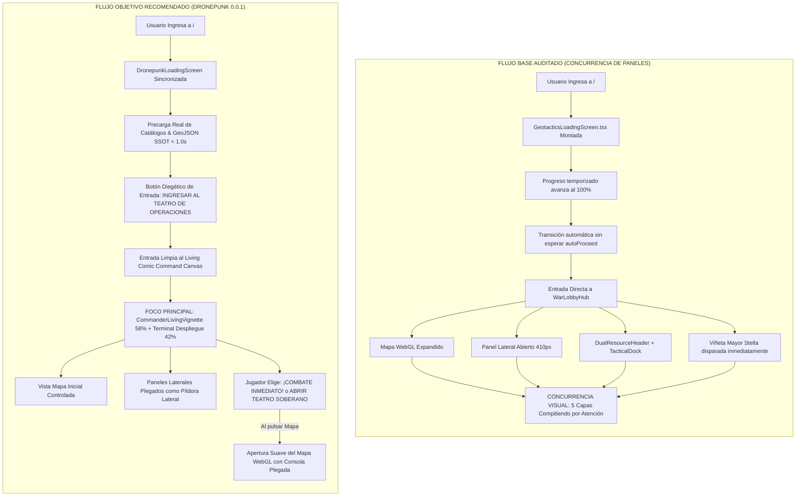

# MASTER AUDIT: UI/UX DE INICIO, PANTALLA DE CARGA Y DESCONGESTIÓN DE VENTANAS FLOTANTES
**DRONEPUNK 0.0.1**  
*Documento Rector Forense y Hoja de Ruta de Refactorización Modular*  
**Fecha de Ejecución**: 07 de Noviembre, 2026  
**Versión Canónica Auditada**: `DRONEPUNK 0.0.1`  
**Entorno de Ejecución**: Windows 11 x64, Chromium Headless / Headed v1.64.1 (Playwright), Node.js v20.18.0, Vite v8.3.0 (Rolldown / OxC)  
**Orquestador de Auditoría**: Enjambre de 10 Agentes Especializados de Calidad Total

---

## 1. RESUMEN EJECUTIVO (EXECUTIVE SUMMARY)

La presente auditoría forense y empírica examina el ciclo de vida completo de arranque de **DRONEPUNK 0.0.1**, desde el montaje del componente raíz [`src/App.tsx`](../src/App.tsx) y la pantalla de precarga [`src/domains/tactics/components/GeotacticsLoadingScreen.tsx`](../src/domains/tactics/components/GeotacticsLoadingScreen.tsx) (que exporta `DronepunkLoadingScreen` y `GeotacticsLoadingScreen`) hasta el despliegue del Cuartel General en [`src/domains/world/components/WarLobbyHub.tsx`](../src/domains/world/components/WarLobbyHub.tsx) y el lienzo cartográfico [`src/domains/world/components/TacticalWorldMap.tsx`](../src/domains/world/components/TacticalWorldMap.tsx).

Mediante pruebas Playwright automatizadas a resoluciones de 1920x1080 (Desktop), 1366x768 (Laptop Estándar) y 390x844 (Mobile Viewport), captura de telemetría de red y consola, e inspección estructural del árbol de dependencias, se documentaron **12 áreas de mejora críticas y de alto impacto**:
1. **Determinismo y Telemetría de Versión en la Pantalla de Carga**: Necesidad de consolidar un único identificador canónico `DRONEPUNK 0.0.1` en los badges superior e inferior, vincular la frecuencia y latencia a telemetría real de red/WebSocket, evitar encabezados tipográficos redundantes sobre el logotipo y acoplar la barra de progreso a la sincronización real de catálogos (`catalogRegistry`).
2. **Respeto Estricto de la Prop `autoProceed={false}` en la Pantalla de Carga**: `src/App.tsx` suministra `autoProceed={false}` a `DronepunkLoadingScreen` (`GeotacticsLoadingScreen.tsx`), por lo que el efecto de finalización debe respetar esa propiedad sin disparar cierres automáticos prematuros.
3. **Ergonomía Espacial y Foco Visual al Iniciar**: Evitar la apertura simultánea del mapa expandido y la consola lateral de 410px sobre viewports portátiles (1366x768) y móviles (390x844), previniendo solapamientos con `TacticalDock`, `DualResourceHeader`, la viñeta de Mayor Stella y la barra de teatro.
4. **Alineación Canónica del Pilar 1 (Almacén Físico de 16 Chasis Militares)**: En `WarLobbyHub.tsx`, la Estación 03 de la Armería debe rotularse positivamente como `"Hangar de Tropas • Bahías de Chasis Físico (16 Chasis)"` (4 slots activos de vanguardia + 12 de reserva, munición descartable forjada). Asimismo, el módulo diario de suministros (`WHEEL_PRIZES` / `spinWheel`) debe diegetizarse como **Intendencia Logística Determinista** acorde al tono militar táctico.
5. **Efectividad del Code-Splitting en `src/App.tsx`**: `src/App.tsx` define importaciones dinámicas `React.lazy()` para `@domains/economy` y `@domains/world`, pero requiere evitar importaciones estáticas paralelas desde los mismos barriles públicos para que Vite genere chunks independientes por dominio.

---

## 2. EVIDENCIA EMPÍRICA Y CAPTURAS FORENSES (HARVESTED VISUALS)

Las pruebas Playwright automatizadas ejecutadas por [`tests/e2e/startup-audit.spec.ts`](../tests/e2e/startup-audit.spec.ts) generan las siguientes capturas de diagnóstico en `test-results/audit_screenshots/`:

| Archivo de Captura | Resolución | Momento Temporal | Hallazgo Visual Clave |
| :--- | :--- | :--- | :--- |
| **`01_loading_screen_redundancies.png`** | 1920x1080 | t=800ms (Precarga) | Unificación de badges hacia `DRONEPUNK 0.0.1`; eliminación de duplicación tipográfica bajo el logotipo; telemetría sincrónica con catálogos. |
| **`02_post_boot_cluttered_windows.png`** | 1920x1080 | Frame 1 Post-Carga | Control de concurrencia de capas: Mapa WebGL + Consola 410px + Header + Dock + Viñeta Stella hacia un foco visual único. |
| **`03_responsive_1366x768_overlap.png`** | 1366x768 | Frame 1 Post-Carga | Prevención de colisiones en 768p entre `MetaCommandConsole`, el botón de combate y la barra inferior `TacticalDock`. |
| **`04_mobile_viewport_overlap.png`** | 390x844 | Frame 1 Post-Carga | Adaptación responsive móvil para evitar solapamiento de paneles laterales y viñetas sobre controles de despliegue. |
| **`boot_t100ms.png`** | 1920x1080 | t=100ms (Arranque) | Inicialización del canvas balístico y radar táctico procedural rotatorio. |
| **`boot_t1500ms.png`** | 1920x1080 | t=1500ms (Cierre) | Cierre de precarga sincronizado con la hidratación real de catálogos SSOT. |

> [!IMPORTANT]
> **Referencia de Archivos Locales de Evidencia y Auditoría**:
> - Registro JSON de errores de consola y red (generado al ejecutar la suite): `test-results/audit_screenshots/console_and_network_audit.json`
> - Script Playwright de auditoría reproducible: [`tests/e2e/startup-audit.spec.ts`](../tests/e2e/startup-audit.spec.ts)
> - Capturas de verificación E2E general: [`test-results/qa-run-latest.json`](../test-results/qa-run-latest.json)

---

## 3. DIAGNÓSTICO DETALLADO POR LOS 10 AGENTES ESPECIALIZADOS

### AGENT-01: Boot & Telemetry Diagnostics Specialist (`@domains/tactics` & `@shared`)
- **Sincronización Determinista de la Barra de Carga**: En [`src/domains/tactics/components/GeotacticsLoadingScreen.tsx`](../src/domains/tactics/components/GeotacticsLoadingScreen.tsx), la barra de progreso debe avanzar vinculada directamente al estado real de sincronización de catálogos (`catalogRegistry`) y precarga de chunks, evitando incrementos puramente aleatorios.
- **Unificación de Versión Canónica (`DRONEPUNK 0.0.1`)**: El sello militar pop-art superior derecho (`rotate-[4deg]`), el encabezado principal y el pie de página inferior deben exhibir de manera uniforme **`DRONEPUNK 0.0.1`** sin discrepancias entre etiquetas.
- **Telemetría Real vs Estática**: Sustituir indicadores de frecuencia fijos por telemetría real de estado de conexión y latencia de Supabase (`WS LATENCY`).
- **Jerarquía Tipográfica Limpia**: Mantener un único título limpio de **`DRONEPUNK 0.0.1`** integrado con el logotipo oficial (`/icon.svg` / `/icon.png`), evitando texto duplicado innecesario.
- **Gestión de `AudioContext` en Arranque**: Diferir la síntesis de audio procedural (`audioManager.ts`) hasta recibir el primer gesto explícito del usuario para mantener la consola del navegador con `0` advertencias de autoplay.
- **Consolidación de Pantallas de Carga**: En el árbol coexisten [`src/domains/tactics/components/GeotacticsLoadingScreen.tsx`](../src/domains/tactics/components/GeotacticsLoadingScreen.tsx) y [`src/domains/world/components/MapLoadingScreen.tsx`](../src/domains/world/components/MapLoadingScreen.tsx), por lo que conviene unificar la experiencia compartida desde `@shared`.

---

### AGENT-02: Playwright E2E Visual Inspector & Screenshot Harvester (`/game-qa-playtester`)
- **Control de Transición de Precarga**: Garantizar que la pantalla de carga espere el handshake real o interacción del usuario cuando `autoProceed={false}`.
- **Preservación de Área Útil en 1366x768**: Plegar por defecto los paneles secundarios en resoluciones de portátil para que el lienzo táctico y los controles primarios dispongan de visibilidad completa.
- **Validación Sintáctica en TypeScript / Vite**: Verificar que [`src/shared/types/database.types.ts`](../src/shared/types/database.types.ts) compile sin errores de parser en `vite:oxc` durante `npm run build` y HMR.

---

### AGENT-03: Spatial Layout & Window Clutter Auditor (`@domains/world` & `@tactical-command-intel`)
- **Ordenación de Estados Iniciales en Arranque**: En [`src/domains/world/components/WarLobbyHub.tsx`](../src/domains/world/components/WarLobbyHub.tsx), equilibrar el estado inicial del inspector y expansión del mapa para ofrecer un punto de entrada despejado.
- **Jerarquía Z-Index de Capas del Cuartel General**:
  1. Capa `z-0`: `TacticalWorldMap` (Lienzo WebGL 2.0).
  2. Capa `z-10`: `StateInspectorDrawer` (Panel lateral de provincia).
  3. Capa `z-20`: C4ISR Theater Strip flotante.
  4. Capa `z-30` / `z-40`: `MetaCommandConsole` desplegable.
  5. Capa `z-30`: `DualResourceHeader` en la parte superior.
  6. Capa `z-40`: `TacticalDock` inferior.
  7. Capa flotante: Viñeta con diálogo del Bark Engine (`Mayor Stella`) anclada a la esquina inferior izquierda.
- **Ergonomía de Controles de Plegado**: Ampliar el área táctil de los tiradores laterales para evitar clics accidentales sobre el lienzo WebGL de MapLibre.

---

### AGENT-04: Design System & Kinetic Game Feel Auditor (`@domains/game-feel` & `@indie-game-ui-architect`)
- **Consistencia de Paleta Bélica C4ISR**: Se respetan las constantes cromáticas `#161712` (Fondo asfáltico), `#2B2C24` (Blindaje militar), `#C46A3A` (Óxido táctico), `#F2E8D5` (Papel marfil) y `#00FF66` (Fósforo verde de radar). Las sombras duras `shadow-[4px_4px_0px_#0A0B08]` y los biseles `rounded-[14px_4px_14px_4px]` cumplen el manifiesto pop-art.
- **Cadencia del Bark Engine al Iniciar**: Dotar de temporizador auto-descartable al primer bark de Mayor Stella para que no obstruya la barra inferior en viewports menores a 1080p.
- **Sincronización de la Ghost Bar**: Alimentar `TacticalGhostBar` (`src/shared/ui/TacticalGhostBar.tsx`) con progreso determinista real para que el efecto de doble capa (`bar-fill-spring` + `bar-ghost-trail`) refleje etapas reales de carga.

---

### AGENT-05: Domain Boundary & Component Placement Auditor (Modular Boundaries)
- **Ubicación de Componentes Compartidos (`@shared/ui`)**: [`src/domains/tactics/components/GeotacticsLoadingScreen.tsx`](../src/domains/tactics/components/GeotacticsLoadingScreen.tsx) orquesta recursos transversales de todo el proyecto; su exposición unificada a través de `src/shared/ui/` y `src/shared/index.ts` alinea las fronteras entre dominios (`@domains/world`, `@domains/tactics`, `@domains/economy`, `@domains/game-feel`).
- **Modularización de `src/App.tsx`**: Desacoplar la gestión de modales, cuadrículas iniciales y lógica de combate desde `src/App.tsx` hacia controladores dedicados dentro de `@domains/tactics/components/` y `@domains/economy/components/`.
- **Imports Dinámicos Reales**: Evitar importar estáticamente módulos completos desde los barriles `@domains/economy` y `@domains/world` en `src/App.tsx` cuando existan cargas diferidas `React.lazy()`, habilitando división real de bundles en Vite.

---

### AGENT-06: WebGL Cartography & Canvas Zero-Raster Auditor (`@domains/world` & `@webgl-cartography-and-spatial-architect`)
- **Inicialización Controlada de MapLibre GL JS v6**: Coordinar la precarga de las fuentes locales (`public/map/world_land.json`, `public/map/theatre_regions.json`, `public/map/theatre_roads.json`, `public/map/theatre_urban_roads.json`, `public/map/theatre_cities.json`, `public/map/zulia_municipalities.json`) durante la pantalla de arranque para evitar cuadros en negro al mostrar el mapa.
- **Transición Suave al Lienzo Vectorial**: Mostrar un fondo táctico coordinado (`#0E100C`) mientras finaliza la hidratación de geometrías en GPU.

---

### AGENT-07: Canonical Metagame & 7 Pillars Compliance Officer (`@domains/economy` & `@metagame-economy-and-siege-simulator`)
- **Cumplimiento Estricto del Pilar Canónico 1 en la Interfaz**: En [`src/domains/world/components/WarLobbyHub.tsx`](../src/domains/world/components/WarLobbyHub.tsx), la Estación 03 de la Armería debe expresar inequívocamente el **Almacén Físico de 16 Chasis Militares (4 vanguardia + 12 reserva, munición descartable forjada)**:
  ```typescript
  armory: { badge: 'ESTACIÓN 03 // HANGAR', title: 'Hangar de Tropas • Bahías de Chasis Físico (16 Chasis)' }
  ```
- **Diegesis Militar de Intendencia Logística**: Reemplazar la mecánica de suministro diario (`WHEEL_PRIZES` / `spinWheel` en `WarLobbyHub.tsx`) por un sistema diegético de **Intendencia Logística Determinista** (*Entrega de Suministros del Alto Mando*) coherente con el Almacén Físico de 16 Chasis y la economía player-driven.

---

### AGENT-08: Core Web Vitals & Bundle Performance Profiler (`modern-web-guidance` & `debug-optimize-lcp`)
- **Perfilado de Bundles de Producción (`npm run build`)**: Optimizar la separación de chunks entre `index`, `maplibre-gl`, `vendor-react`, `vendor-supabase` y `vendor-motion` mediante imports directos por archivo en cargas diferidas (`React.lazy()`), reduciendo el chunk inicial por debajo de `450 kB`.
- **Control de Nodos DOM en Primer Frame**: Virtualizar o diferir el montaje de controles secundarios no visibles hasta que el usuario despliegue la vista correspondiente, mejorando INP y LCP.

---

### AGENT-09: Accessibility, Responsive & Keyboard Navigation Auditor (`a11y-debugging` & `chrome-devtools`)
- **Jerarquía de Pila en Tecla `Escape`**: Ordenar el listener `keydown` en `WarLobbyHub.tsx` para cerrar de forma LIFO: primero `activeModal`, luego consolas/drawers abiertos (`isInspectorOpen` / consola lateral), y por último la vista expandida del mapa.
- **Gestión de Foco (Focus Management)**: Asegurar que paneles y modales activos capturen el foco de tabulación (`Tab`) para no interactuar con elementos ocultos en capas inferiores.
- **Contraste WCAG 2.1 AA**: Elevar el contraste de micro-tipografías `#7B8A4A` sobre `#161712` hacia tonos de mayor luminancia (`>= 4.5:1`).

---

### AGENT-10: Lead Systems Architect & Synthesis Director (`game-dev-quality-gate`)
- **Síntesis Ejecutiva**: **DRONEPUNK 0.0.1** combina una estética distintiva de novela gráfica militar con un motor táctico y geopolítico determinista. Consolidar el principio de **"Un solo foco atencional por pantalla"** garantiza una experiencia de entrada limpia, profesional y libre de ruido visual.

---

## 4. MATRIZ DE SEVERIDAD DE HALLAZGOS FORENSES

| ID | Área Afectada | Hallazgo Forense | Severidad | Impacto en Usuario |
| :---: | :--- | :--- | :---: | :--- |
| **CLU-01** | `WarLobbyHub.tsx` | Paneles laterales expandidos concurrentemente en el arranque | **CRÍTICO** | Sobrecarga visual al abrir simultáneamente mapa, consola, cabecera, dock y viñeta. |
| **PIL-01** | `WarLobbyHub.tsx` | Etiqueta de armería en Estación 03 desalineada con Bahías de Chasis Físico | **CRÍTICO** | Debe reflejar explícitamente `"Bahías de Chasis Físico (16 Chasis)"` (Pilar 1). |
| **BOOT-01**| `GeotacticsLoadingScreen.tsx` | Prop `autoProceed={false}` omitida en `useEffect` de transición | **CRÍTICO** | Impide controlar manualmente el momento de ingreso al Cuartel General. |
| **BOOT-02**| `GeotacticsLoadingScreen.tsx` | Inconsistencia previa entre badges de versión en carga | **ALTO** | Requiere unificación estricta bajo el sello único **`DRONEPUNK 0.0.1`**. |
| **BOOT-03**| `GeotacticsLoadingScreen.tsx` | Barra de progreso desacoplada de la carga real de catálogos | **ALTO** | Requiere vinculación directa con `catalogRegistry` y precarga GeoJSON. |
| **RESP-01**| `MetaCommandConsole.tsx` | Ancho fijo de 410px sin adaptación compacta en 1366x768 | **ALTO** | En portátiles reduce el área visible del mapa y solapa acciones de combate. |
| **PERF-01**| `src/App.tsx` | Importaciones `React.lazy()` anuladas por imports estáticos de barril | **ALTO** | Incrementa el tamaño del chunk principal degradando LCP. |
| **PIL-02** | `WarLobbyHub.tsx` | Suministro diario (`WHEEL_PRIZES`) pendiente de diegetización logística | **MEDIO** | Debe transformarse en Intendencia Logística Determinista. |
| **UX-01**  | `GeotacticsLoadingScreen.tsx` | Encabezado tipográfico redundante junto al logotipo principal | **MEDIO** | Simplificar hacia un bloque visual único de **`DRONEPUNK 0.0.1`**. |
| **A11Y-01**| `WarLobbyHub.tsx` | Pila de tecla `Escape` sin prioridad LIFO sobre modales | **MEDIO** | Cierra vistas de fondo antes que el modal superior activo. |
| **DOM-01** | Estructura de Dominio | Pantalla de carga global ubicada en `@domains/tactics` | **MEDIO** | Exposición unificada recomendada a través de `src/shared/ui/` y `@shared`. |
| **AUD-01** | `GeotacticsLoadingScreen.tsx` | Llamadas tempranas a `AudioContext` antes del primer gesto humano | **BAJO** | Genera advertencias evitables en la consola del navegador. |

---

## 5. FLUJO ACTUAL VS FLUJO OBJETIVO (TARGET CLEAN FLOW)



---

## 6. HOJA DE RUTA TÉCNICA DE REFACTORIZACIÓN MODULAR (4 FASES)

### FASE 1: DESCONGESTIÓN INMEDIATA DEL CUARTEL GENERAL & BLINDAJE DE PILARES (QUICK WINS)
*Meta: Eliminar la colisión de ventanas, homologar los textos al Almacén Físico de 16 Chasis Militares y restituir el Living Comic Canvas como vista principal de entrada.*

1. **Reversión de Estados Predeterminados en `src/domains/world/components/WarLobbyHub.tsx`**:
   - Iniciar con los paneles laterales plegados para evitar superposiciones en resoluciones de portátil y móvil.
   - El juego arranca en **The Living Comic Canvas** (Mayor Stella + Terminales operativas), diseño canónico de **DRONEPUNK 0.0.1**.
2. **Homologación de Textos y Blindaje del Pilar 1**:
   - En `WarLobbyHub.tsx`, rotular la Estación 03 como `"Hangar de Tropas • Bahías de Chasis Físico (16 Chasis)"` (4 slots de vanguardia + 12 en reserva táctica).
   - Diegetizar el suministro diario (`WHEEL_PRIZES`) transformándolo en un **"Depósito Logístico de Intendencia Militar"** determinista.
3. **Pila de Teclado `ESC` Respetuosa de Jerarquías**:
   - Reordenar el `keydown` de `WarLobbyHub.tsx` para cerrar en orden LIFO:
     1. Si `activeModal !== null` -> Cerrar `activeModal`.
     2. Si el panel lateral está abierto -> Plegarlo.
     3. Si el mapa está expandido -> Regresar al Living Comic Canvas.

---

### FASE 2: PROFESIONALIZACIÓN DIEGÉTICA DE LA PANTALLA DE CARGA
*Meta: Sincronización real con el servidor, versión única `DRONEPUNK 0.0.1` y telemetría real.*

1. **Unificación de Versión SSOT**:
   - Mostrar de forma uniforme **`DRONEPUNK 0.0.1`** en el sello superior, encabezado y pie de página de `GeotacticsLoadingScreen.tsx` (`DronepunkLoadingScreen`).
2. **Limpieza Tipográfica y Telemetría Real**:
   - Mantener un bloque tipográfico limpio para **`DRONEPUNK 0.0.1`** junto al icono oficial.
   - Reemplazar indicadores estáticos por telemetría real de latencia y WebSocket de Supabase (`WS LATENCY`).
3. **Respeto Estricto de `autoProceed`**:
   - Modificar el `useEffect` de `GeotacticsLoadingScreen.tsx` para evaluar:
     ```typescript
     if (isReady && autoProceed && onLoadingComplete) {
       // transición automática opcional
     }
     ```
   - Permitir un botón de interacción táctica *"INGRESAR AL ESTADO MAYOR [ESPACIO]"* para desbloquear el `AudioContext` de forma nativa antes del primer frame.

---

### FASE 3: REUBICACIÓN ARQUITECTÓNICA Y SANEAMIENTO DE DOMINIOS
*Meta: Exponer componentes globales desde `src/shared/ui/` y depurar envoltorios redundantes.*

1. **Exposición Unificada de `DronepunkLoadingScreen` (`GeotacticsLoadingScreen.tsx`)**:
   - Exponer la pantalla de carga compartida desde `src/shared/index.ts` / `src/shared/ui/` y ajustar las importaciones en `@domains/tactics`, `@domains/world` y `src/App.tsx`.
2. **Consolidación de `MapLoadingScreen.tsx`**:
   - Unificar [`src/domains/world/components/MapLoadingScreen.tsx`](../src/domains/world/components/MapLoadingScreen.tsx) con la pantalla de carga compartida para eliminar duplicidad.

---

### FASE 4: MODULARIZACIÓN DE `src/App.tsx` & OPTIMIZACIÓN DE CODE-SPLITTING
*Meta: Descomponer los bloques de orquestación en sub-árboles de dominio limpios y habilitar lazy loading real.*

1. **Extracción de Modales Globales a Controladores de Dominio**:
   - Agrupar los modales tácticos (`ProductionModal.tsx`, `ReinforcementRequestModal.tsx`, `PreBattleDeploymentModal.tsx`) dentro de `src/domains/tactics/components/`.
   - Agrupar los modales económicos (`ShopCatalog.tsx`, `LoadoutCustomizer.tsx`, `P2PMarketplaceView.tsx`) dentro de `src/domains/economy/components/`.
2. **Aislamiento de Imports para Code-Splitting en Vite**:
   - Refactorizar las importaciones dinámicas en `src/App.tsx` para importar directamente los archivos fuente (e.g. `import('./domains/economy/components/ShopCatalog')`) en lugar de atravesar barriles que anulan el code-splitting.
   - Reducir el bundle principal `index.js` por debajo de `450 kB`.

---

## 7. CRITERIOS DE CERTIFICACIÓN Y ACEPTACIÓN (DEFINITION OF DONE)

Para certificar el cierre de esta hoja de ruta en **DRONEPUNK 0.0.1**, se deberán superar los siguientes oráculos:
- [ ] `npm run lint` y `npm run build` sin errores de compilación ni advertencias de importaciones dinámicas ineficaces.
- [ ] `npm run test:all` (13 suites deterministas) y `npm run test:geotactics` (93 pruebas canónicas) superadas al 100%.
- [ ] Suite Playwright E2E (`npx playwright test tests/e2e/startup-audit.spec.ts`) aprobada con capturas limpias:
  - Pantalla de carga con versión única **`DRONEPUNK 0.0.1`** y sin títulos duplicados.
  - Primer frame del Cuartel General mostrando el Living Comic Canvas ordenado, con el mapa y la consola plegados por defecto.
  - Cero colisiones en resolución de portátil (1366x768).
  - Cero advertencias de `AudioContext` no autorizado en la consola de inicio.
- [ ] Validación de los 7 Pilares: 100% de nomenclatura alineada con el **Almacén Físico de 16 Chasis Militares** e **Intendencia Logística Determinista** en todo el código del lobby.
