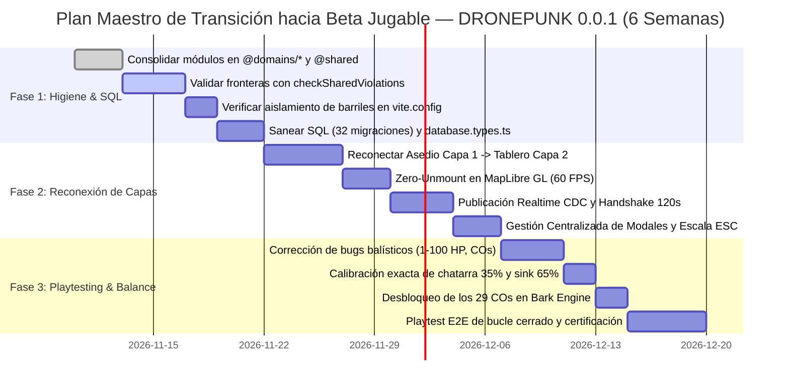

# 🛰️ DIAGNÓSTICO ESTRATÉGICO, RADIOGRAFÍA DE PUNTOS CIEGOS Y ROADMAP HACIA LA BETA JUGABLE
**DRONEPUNK 0.0.1**  
**Comité de Auditoría:** Enjambre de 10 Auditores Especializados (B01 a B10) + Lead Game Director (B11)  
**Fecha de Certificación:** 07 de Noviembre de 2026  
**Documento Rector:** `docs/DIAGNOSTICO_META_Y_ROADMAP_BETA.md`  
**Estado:** Dictamen Estratégico Aprobado — Plan Maestro de Transición hacia Beta Jugable (`DRONEPUNK 0.0.1`)

---

## 1. RADIOGRAFÍA CRÍTICA DE PUNTOS CIEGOS Y SESGOS DEL FLUJO ACTUAL

A pesar de que el proyecto compila limpiamente (`npm run build`, exit code 0) y aprueba sus suites deterministas (`npm run test:all`, `npm run test:geotactics`), la auditoría transversal del Comité de 10 Subagentes Especializados identificó áreas donde el proyecto debe evitar cualquier **Sesgo de Complacencia Automatizada**: validar subsistemas aislados no sustituye la integración completa del bucle principal entre **@domains/world**, **@domains/tactics**, **@domains/economy**, **@domains/game-feel** y **@shared** bajo las reglas matemáticas de **DRONEPUNK 0.0.1**.

A continuación, se exponen los **3 Focos Críticos de Endurecimiento**:

```
+----------------------------------------------------------------------------------------------------+
|                                    LOS 3 FOCOS DE ENDURECIMIENTO                                   |
+----------------------------------------------------------------------------------------------------+
| 1. CONSOLIDACIÓN MODULAR Y CONTRATOS SQL (32 MIGRACIONES):                                         |
|    Aislamiento estricto de los 4 dominios (@domains/world, @domains/tactics, @domains/economy,     |
|    @domains/game-feel) y @shared; alineación completa de database.types.ts y                       |
|    CONSOLIDATED_FULL_DATABASE_DEPLOY.sql con las 32 migraciones SQL.                               |
+----------------------------------------------------------------------------------------------------+
| 2. CONECTIVIDAD DEL CORE LOOP (CAPA 1 GEOPOLÍTICA -> CAPA 2 TÁCTICA):                              |
|    Acoplar declaración de asedio en MapLibre con TerritorySiegeModal y CombatTheaterView;          |
|    suscripción CDC en supabase_realtime para territorial_battle_sessions y reconexión en vivo.     |
+----------------------------------------------------------------------------------------------------+
| 3. CALIBRACIÓN MATEMÁTICA Y BALÍSTICA (ESCALA 1-100 HP Y SUMIDERO 65% / 35% SCRAP):                |
|    Asegurar escala continua 1-100 HP en todos los poderes de CO y capturas, paridad de matriz      |
|    CANONICAL_DAMAGE_CHART, liquidación exacta del 35% tech_scrap e IA de Guarnición Nv. 1-5.      |
+----------------------------------------------------------------------------------------------------+
```

---

### FOCO 1: Consolidación Arquitectural de Dominios y Esquema SQL
- **Aislamiento Estricto de los 4 Dominios**: La arquitectura de producción se organiza exclusivamente bajo `src/domains/world/`, `src/domains/tactics/`, `src/domains/economy/`, `src/domains/game-feel/` y `src/shared/`, evitando cualquier dependencia hacia módulos históricos previos a la modularización.
- **Higiene de Bundling en Vite**: Mantener la separación de chunks en `vite.config.ts` alineada únicamente a los 4 dominios y dependencias vendor (`react`, `maplibre-gl`, `supabase`), evitando empaquetado redundante.
- **Suites de Pruebas en Escala Canónica**: Todas las suites bajo `src/domains/*/__tests__/` deben importar exclusivamente desde los barriles públicos (`@domains/*`, `@shared`) y operar estrictamente con integridad continua de `1` a `100 HP` (`CANONICAL_MAX_HP = 100`, Pilar 2).
- **Consolidación SQL (32 Migraciones)**: `supabase/CONSOLIDATED_FULL_DATABASE_DEPLOY.sql` debe reflejar íntegramente las **32 migraciones SQL** de `supabase/migrations/` (`20261024` a `20261110`, incluyendo `20261110_fix_database_audit_regressions.sql`), centradas en el **Almacén Físico de 16 Chasis Militares** (`public.user_unit_hangar`), mapa de Venezuela (`REG_VE_01`..`REG_VE_24` + `BUF_MARITIME_CARIBE` + 7 zonas buffer `BUF_*`), soberanía dual y ventanas de vulnerabilidad.
- **Tipado Estricto (`database.types.ts`)**: `src/shared/types/database.types.ts` debe mantenerse regenerado y sincronizado con las 32 migraciones para erradicar casts `(supabase as any)` en los servicios de persistencia.

---

### FOCO 2: Conectividad Viva del Core Loop (Capa 1 → Capa 2)
- **Activación del Combate Táctico desde Asedios**: En `src/domains/world/core/politicalAliceEngine.ts`, coordinar la transición desde la Capa 1 hacia el tablero táctico 20x20 (`CombatTheaterView.tsx`) cuando se declara un asedio territorial real.
- **Flujo Vivo en `App.tsx` y `WarLobbyHub.tsx`**: Conectar `handleStartMatchFromLobby` con el flujo de despliegue pre-batalla (`PreBattleDeploymentModal.tsx`) y la apertura efectiva de `CombatTheaterView.tsx` y `TerritorySiegeModal.tsx`.
- **Netcode Realtime en Supabase**: Mantener `public.territorial_battle_sessions` publicada en `supabase_realtime` (`20261110_fix_database_audit_regressions.sql`) para propagar eventos de Handshake de 120s en tiempo real.
- **Sincronización y Reconexión de Partidas (`useMatchSync.ts`)**: Montar `useMatchSync.ts` en `CombatTheaterView.tsx` asegurando persistencia de snapshots y deltas incrementales para la RPC `rpc_reconnect_match_state`.

---

### FOCO 3: Calibración Matemática, Economía 65%/35% y Balística 1-100 HP
- **Equilibrio de Fundición y Sumidero Deflacionario (Pilar 6)**:
  - En `settle_territorial_combat_losses` y `settleCombatLossesAndScrap`, un chasis destruido quema irreversiblemente el **65%** de su valor material y acredita exactamente el **35% en `tech_scrap`** (`RECYCLE_SCRAP_RATE = 0.35`, `SALVAGE_TECH_SCRAP_RATE = 0.35`), manteniendo el coste de forja de chasis en `industrialEngine.ts` estrictamente por encima del retorno de reciclaje para impedir cualquier bucle inflacionario.
- **Acreditación Completa en el Mercado P2P 100% Player-Driven**: La RPC `execute_p2p_market_transaction` / `execute_p2p_trade_v2` debe acreditar de forma atómica tanto chasis físicos como materias primas y materiales refinados en `user_industrial_inventory`, aplicando el split canónico del **2%** (1% Burn Sink + 1% Clan Hub) y bandas **VWAP Collar ±25%**.
- **Calibración Integral 1-100 HP en Poderes de CO (`coSystem.ts`)**:
  - Todas las habilidades de reparación y daño global (Andy, Hawke, Sturm, Drake, Olaf, Rachel) operan proporcionalmente sobre la escala continua de **1 a 100 HP** (ej. Andy `+20` / `+50 HP`, Hawke `-10` / `-20 HP`), con carga del medidor calibrada al coste completo en escala 1-100.
- **Polaridad Defensiva y Cobertura de Arquetipos (`combat.ts` & `canonicalDamageChart.ts`)**:
  - Asegurar que bonos defensivos positivos (Kanbei `+20%` armadura) reduzcan efectivamente el daño recibido y que `neotank`, `apc`, `t_copter` y `missiles` cuenten con entradas completas en `CANONICAL_DAMAGE_CHART`.
- **Ritmo de Captura, Niebla de Guerra e IA Nv. 5 (`captureSystem.ts` & `garrisonAIEngine.ts`)**:
  - Escalar los puntos de captura proporcionalmente a `Math.ceil(unit.hp / 10)` para preservar el ritmo de 2 turnos, validar visibilidad en niebla de guerra para fuego indirecto y completar la búsqueda heurística multi-ply de la IA de Guarnición Nivel 5 (`mcts_legendary`).
- **Desbloqueo del Bark Engine para los 29 Comandantes (`barkEngine.ts`)**:
  - Permitir alternar dinámicamente los **29 Comandantes Canónicos** (`CANONICAL_CO_REGISTRY`) además de Mayor Stella como Comandante Especial IA #29.

---

## 2. EVALUACIÓN DE MADUREZ DE LOS 4 DOMINIOS (% REAL PARA LA BETA)

| Dominio Funcional | % Madurez Código | % Conectividad Viva | % Madurez Real Beta | Dictamen Crítico del Comité de Auditoría |
| :--- | :---: | :---: | :---: | :--- |
| **@domains/world**<br>*(Cartografía, Asedios, Red Vial, Clanes)* | **92%** | **45%** | **68%** | **Excelente base espacial, integración en curso.** MapLibre GL v6 opera a 60 FPS con proyección $O(1)$ y red vial de 15 nodos en Cabimas. Requiere desacoplar `hoveredCell` de `setData()`, evitar filtros CSS `blur` sobre el contenedor WebGL y enlazar la declaración de asedios con el combate táctico. |
| **@domains/tactics**<br>*(Motor Balístico, 29 COs, IA Guarnición)* | **88%** | **30%** | **59%** | **Motor de combate robusto pendiente de acople en vivo.** El simulador TBS 20x20 es determinista en 1-100 HP, requiriendo calibración uniforme de poderes CO en escala 1-100 HP, signo defensivo, paridad de `CANONICAL_DAMAGE_CHART` y conexión directa desde el lobby geopolítico. |
| **@domains/economy**<br>*(10 Parcelas, Hangar 16 Chasis, Mercado P2P)* | **85%** | **50%** | **67%** | **Doble Llave sólida y mercado 100% player-driven.** La forja de chasis y el mercado P2P al 2% (1% burn + 1% clan) y VWAP Collar ±25% requieren consolidar el balance de reciclaje 35% `tech_scrap`, la acreditación de materiales en la RPC P2P y el tope de 16 chasis en base de datos. |
| **@domains/game-feel**<br>*(Web Audio procedural, Háptica, Bark Engine)* | **90%** | **60%** | **75%** | **Inmersión artística sobresaliente.** Síntesis procedural Web Audio API y ducking dinámico operativos; pendiente alinear claves de audio/háptica invocadas en UI y habilitar los 29 comandantes en `barkEngine.ts`. |
| **@shared & Backend**<br>*(Supabase, 32 Migraciones, Netcode)* | **75%** | **30%** | **52%** | **Infraestructura en consolidación.** Publicación CDC de `territorial_battle_sessions`, sincronización de snapshots de reconexión, `CONSOLIDATED_FULL_DATABASE_DEPLOY.sql` actualizado a las 32 migraciones y unificación de `public.profiles`. |
| **PROMEDIO PONDERADO DEL PROYECTO** | **86.0%** | **43.0%** | **64.2%** | **ESTADO ALFA ESTABILIZADO EN MOTOR / CONECTIVIDAD EN ENDURECIMIENTO.** |

---

## 3. EL "META" DE DESARROLLO: METODOLOGÍA, HERRAMIENTAS Y CADENCIA DE SPRINTS

Para consolidar la **BETA JUGABLE CERRADA** de **DRONEPUNK 0.0.1** en 6 semanas de desarrollo determinista, se establece el siguiente **META de Desarrollo**:

```
+----------------------------------------------------------------------------------------------------+
|                                    EL "META" DE DESARROLLO CANÓNICO                                 |
+----------------------------------------------------------------------------------------------------+
| 1. CADENCIA DE TRABAJO:                                                                            |
|    Sprints semanales de 5 días con "Freeze de Calidad" obligatorio los viernes.                     |
|    Regla de Cero Regresiones: Ningún PR se aprueba sin compilar limpio y pasar test:all.           |
+----------------------------------------------------------------------------------------------------+
| 2. HIGIENE ARQUITECTÓNICA "ZERO-COMPROMISE":                                                       |
|    Aislamiento estricto entre los 4 dominios (@domains/*) y @shared.                               |
|    Uso exclusivo de barriles públicos (src/domains/*/index.ts y src/shared/index.ts).              |
|    Erradicación definitiva de (supabase as any) mediante regeneración estricta de database.types.   |
+----------------------------------------------------------------------------------------------------+
| 3. CADENA DE VERIFICACIÓN AUTOMÁTICA EN 4 NIVELES (QUALITY GATE):                                  |
|    Nivel 1: Compilación limpia sin warnings de Vite (npm run build).                                |
|    Nivel 2: Verificación de tipos estricta sin TypeScript errors (npx tsc --noEmit).                |
|    Nivel 3: Suites deterministas de dominio (npm run test:all && npm run test:geotactics).         |
|    Nivel 4: Playtest E2E Multimodal con Playwright sobre el Canvas real (npm run test:qa).         |
+----------------------------------------------------------------------------------------------------+
```

### Herramientas e Instrumentación del Equipo:
- **Playwright Test Runner**: Pruebas E2E sobre Chromium (`tests/e2e/game-playtester.spec.ts`, `tests/e2e/startup-audit.spec.ts`) inspeccionando `window.__TACTICAL_QA_BRIDGE__` (`src/shared/utils/qaHarness.ts`).
- **TSX Test Harness**: Ejecución determinista mediante los scripts oficiales de `package.json` (`npm run test:all`, `npm run test:geotactics`, `npm run test:catalogs`).
- **Supabase CLI Local**: Migraciones SQL idempotentes (`supabase/migrations/`) con test de despliegue sobre Postgres en limpio para verificar `supabase/CONSOLIDATED_FULL_DATABASE_DEPLOY.sql`.
- **Web Audio Context Mock**: Harness de audio para verificar que todas las llamadas a `playCue` tengan una clave válida en `AUDIO_SYNTHESIS_CATALOG` (`src/domains/game-feel/core/audioManager.ts`).

---

## 4. ROADMAP OPERATIVO HACIA LA BETA (PLAN DE 3 FASES)



---

### FASE 1: HIGIENE ARQUITECTÓNICA, FRONTERAS DE DOMINIO Y SANEAMIENTO SQL (Semanas 1 y 2)
**Objetivo:** Blindar la arquitectura modular de 4 dominios + `@shared` y sincronizar la base de datos con las **32 migraciones SQL**.

1. **Consolidación de Módulos y Catálogos SSOT**:
   - Mantener `src/domains/tactics/core/campaignEngine.ts` integrado dentro de `@domains/tactics`.
   - Ejecutar `scripts/syncCatalogsFromDb.ts` para sincronizar los catálogos en `src/shared/data/catalogs.generated.ts`.
   - Verificar todas las suites unitarias en `src/domains/{world,tactics,economy,game-feel}/__tests__/`.
2. **Blindaje de Fronteras entre Dominios**:
   - Validar mediante `scripts/checkLegacyImports.cjs` y `scripts/checkSharedViolations.cjs` que el 100% de las importaciones utilicen los barriles `@domains/*` y `@shared`.
   - Confirmar que `src/App.tsx` importe `CommanderProfileModal` desde `src/shared/auth/CommanderProfileModal.tsx` y los tipos cosméticos desde `src/shared/lib/shopData.ts`.
3. **Optimización de Empaquetado en `vite.config.ts`**:
   - Mantener el chunking limpio para `react`, `maplibre-gl`, `supabase` y cargas asíncronas por dominio.
4. **Saneamiento de Base de Datos y Generación de Tipos**:
   - Consolidar la migración 32 (`supabase/migrations/20261110_fix_database_audit_regressions.sql`):
     - Unificar referencias hacia `public.profiles`.
     - Garantizar restricción única en el almacén físico: `ALTER TABLE public.user_unit_hangar ADD CONSTRAINT uq_user_unit_hangar UNIQUE (user_id, unit_code, tier);`.
     - Aplicar el límite estricto de **16 chasis militares físicos** (`check_user_hangar_capacity_limit`).
     - Incluir `ALTER PUBLICATION supabase_realtime ADD TABLE public.territorial_battle_sessions;`.
     - Acreditar materias primas y materiales refinados en `user_industrial_inventory` dentro de `execute_p2p_market_transaction`.
     - Liquidar bajas en lote mediante `settle_territorial_combat_losses` (65% sumidero irreversible + 35% `tech_scrap`).
   - Mantener `src/shared/types/database.types.ts` y `supabase/CONSOLIDATED_FULL_DATABASE_DEPLOY.sql` sincronizados con las **32 migraciones SQL** mediante `scripts/rebuildConsolidatedDeploy.cjs`.

---

### FASE 2: RECONEXIÓN DE CAPAS, ZERO-UNMOUNT Y NETCODE REALTIME (Semanas 3 y 4)
**Objetivo:** Cerrar el bucle jugable: que un asedio en el mapa abra la partida táctica en vivo y liquide las bajas al concluir.

1. **Reconexión de la Tubería Capa 1 $\to$ Capa 2**:
   - En `src/domains/world/hooks/useTerritoryMap.ts`, conectar `onInitiateSiege(provinceId)` para abrir `TerritorySiegeModal.tsx`.
   - En `src/App.tsx`, enlazar `handleStartMatchFromLobby` con `PreBattleDeploymentModal.tsx` para iniciar el combate táctico.
   - En `TerritorySiegeModal.tsx`, configurar los **4 chasis de vanguardia** (de los 16 del Almacén Físico) y transicionar a `CombatTheaterView.tsx`.
2. **Arquitectura Zero-Unmount en MapLibre GL**:
   - Conservar montado `WarLobbyHub.tsx` / `TacticalWorldMap.tsx` durante el combate mediante visibilidad CSS y pausa del bucle de renderizado para preservar el contexto WebGL 2.0 y los GeoJSON en VRAM.
3. **Optimización de Rendimiento WebGL (60 FPS sin tirones)**:
   - Desacoplar `hoveredCell` del `useEffect` de provincias en `TacticalWorldMap.tsx`, evitando llamadas innecesarias a `provSource.setData()`.
   - Usar `map.setFeatureState({ isSelected: true })` para selección visual de estados y evitar filtros CSS `blur` sobre el contenedor WebGL.
   - Calibrar `minzoom` en `public/map/theatre_roads.json` para optimizar vértices a zoom macro.
4. **Jerarquía Unificada de Modales y Tecla `Escape`**:
   - Centralizar la pila de modales en `src/App.tsx` con un único backdrop compartido y cierre LIFO con `Escape`.
5. **Netcode Realtime y Handshake de 120s**:
   - Operar el **Human Handshake de 120 segundos** (`HUMAN_HANDSHAKE_WINDOW_MS = 120_000`) para emparejar atacante y defensor en `active_matches`, con relevo automático a `pve_garrison` (IA Nv. 1-5) al expirar el reloj.
   - Calcular el tiempo restante de turno en `rpc_reconnect_match_state` usando `turn_deadline - NOW()` y limpiar canales con `supabase.removeChannel(channel)`.

---

### FASE 3: PLAYTESTING DETERMINISTA, GAME FEEL Y BALANCE DE METAGAME (Semanas 5 y 6)
**Objetivo:** Validar todas las fórmulas balísticas en escala 1-100 HP, asegurar paridad 0% Pay-to-Win y certificar el bucle completo.

1. **Calibración Integral de Balística (1-100 HP y 29 Comandantes)**:
   - Asegurar que los poderes de todos los COs en `src/domains/tactics/core/coSystem.ts` operen estrictamente en escala **1-100 HP** y la carga de estrellas use `targetUnitCost / 100`.
   - Validar la polaridad defensiva positiva en `src/domains/tactics/core/combat.ts` y la cobertura completa de unidades en `CANONICAL_DAMAGE_CHART` (`src/domains/tactics/core/canonicalDamageChart.ts`).
   - Calibrar la captura de propiedades con `Math.ceil(unit.hp / 10)` en `src/domains/tactics/core/captureSystem.ts` y bloquear fuego indirecto hacia casillas ocultas en niebla de guerra (`src/domains/tactics/core/fogOfWar.ts`).
2. **Calibración Económica del Sumidero 65% y Chatarra 35% (Pilar 6)**:
   - Verificar en `settleCombatLossesAndScrap` y `settle_territorial_combat_losses` la devolución exacta del **35%** en `tech_scrap` (65% sumidero deflacionario irreversible):
     $$\text{Placas de Acero Reembolsadas} = \lfloor \text{Costo Acero} \times 0.35 \rfloor$$
     $$\text{Tech Scrap} = \text{Placas Reembolsadas} \times 2$$
3. **Desbloqueo de Game Feel & Bark Engine**:
   - Configurar `singleSubjectLock = false` en `src/domains/game-feel/core/barkEngine.ts` para habilitar los **29 Comandantes Canónicos** en combate y viñetas vivas.
   - Homologar todos los textos de derrota en `src/domains/game-feel/core/barkEngine.ts` hacia `"Tus Chasis en el Hangar"` (Almacén Físico de 16 Chasis Militares, Pilar 1).
   - Sincronizar todas las claves de audio en `AUDIO_SYNTHESIS_CATALOG` (`src/domains/game-feel/core/audioManager.ts`) y perfiles en `src/domains/game-feel/core/hapticFeedback.ts`.
4. **Verificación de Calidad Total & Playtest E2E de Bucle Cerrado**:
   - Validar en `tests/e2e/game-playtester.spec.ts` el bucle completo:
     1. Iniciar sesión.
     2. Forjar un Tanque Ligero T1 en el Complejo Industrial (`10` parcelas).
     3. Asignarlo a la vanguardia (`4` activas + `12` reserva) en el Almacén Físico de 16 Chasis.
     4. Declarar asedio territorial en el mapa WebGL Zero-Raster.
     5. Entrar a combate táctico 20x20 (escala 1-100 HP).
     6. Destruir las unidades enemigas (derrota a 0 tropas) o capturar el HQ.
     7. Liquidar bajas (65% sumidero / 35% `tech_scrap`) y actualizar la soberanía provincial.
   - Ejecutar la batería completa:
     ```powershell
     npm run lint && npm run build && npm run test:all && npm run test:geotactics && npm run test:qa
     ```

---

## 5. CONCLUSIÓN Y DECLARACIÓN DEL LEAD GAME DIRECTOR (B11)

**DRONEPUNK 0.0.1** consolida una arquitectura estratégica de alta precisión técnica:
- Un **Teatro Geopolítico WebGL Zero-Raster** con soberanía territorial dual en MapLibre GL v6.
- Un **Motor Táctico Determinista 1-100 HP** con 29 Comandantes, Tiers horizontales T1–T5 (+2% por tier, máx +8%, paridad Tier 1 en competitivo) y 0% Pay-to-Win.
- Una **Economía Player-Driven de 10 Parcelas** con Almacén Físico de 16 Chasis Militares, liquidación 65%/35% `tech_scrap` y Mercado P2P al 2% (1% Sink + 1% Clan, VWAP Collar ±25%).
- Una **Atmósfera Audiovisual Nativa** sintetizada al vuelo con Web Audio API y novela gráfica bélica reactiva.

Con la ejecución disciplinada de este Roadmap de 3 Fases, **DRONEPUNK 0.0.1** consolida la reconexión de sus cuatro dominios para avanzar hacia la **Beta Jugable Cerrada**.

*Certificado por el Comité de Auditoría de DRONEPUNK 0.0.1.*
