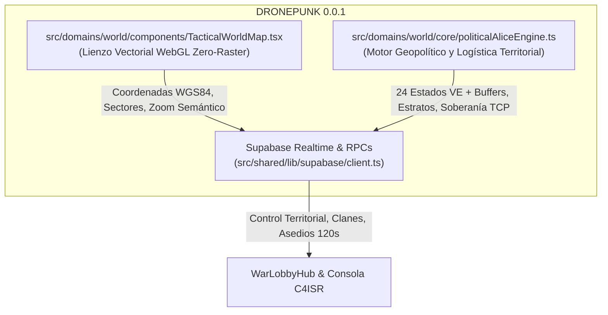

# Análisis de Arquitectura: DRONEPUNK (Documento Histórico Archivado)

> **Estado Documental:** Especificación Histórica Archivada — Alineada a **DRONEPUNK 0.0.1**  
> **Documento:** `docs/archive_legacy/ANALISIS_ARQUITECTURA_GEOTACTICS.md`  
> **Proyecto Matriz:** `DRONEPUNK` (`0.0.1`)  
> **Entorno de ejecución:** Antigravity Cloud Virtual Workspace  
> **Nota de Consolidación:** La arquitectura conceptual analizada originalmente en este documento fue consolidada dentro de los cuatro dominios modulares de **DRONEPUNK 0.0.1** (`@domains/world`, `@domains/tactics`, `@domains/economy`, `@domains/game-feel`) y `@shared`.

---

## 1. Visión y Fundamento del Proyecto

**DRONEPUNK 0.0.1** integra cartografía vectorial WebGL Zero-Raster y simulación geopolítica en tiempo real dentro de una experiencia de estrategia territorial continua:

---

## 2. Análisis Detallado de los Componentes Históricos y su Equivalencia Canónica

### 📍 Módulo 1: Motor Cartográfico Vectorial (`@domains/world`)
* **Propósito:** Proveer la infraestructura de mapa táctico sobre la geografía terrestre real sin dependencia de tiles raster externos.
* **Implementación Canónica en DRONEPUNK 0.0.1:**
  - **Proyección Analítica O(1) y Tiles (`src/domains/world/core/coordinates.ts`):** Conversión WGS84 ↔ cuadrícula táctica y tres estratos de zoom (`ZOOM_GLOBAL = 3.5`, `ZOOM_OPERACIONAL = 10.0`, `ZOOM_TACTICO = 15.0`) con soporte para trazado logístico de suministros.
  - **Niebla Binaria Compacta (`src/domains/world/core/tacticalBitmap.ts`):** Empaquetado binario de niebla de guerra en 50 bytes.
  - **Sistema de Alianzas y Clanes (`src/domains/world/core/clanSystem.ts`):** Gestión de bóvedas de clan, sectores territoriales y regalías P2P del 1%.

### ⚔️ Módulo 2: Simulación Geopolítica e Industrial (`@domains/world` & `@domains/economy`)
* **Propósito:** Proveer la profundidad económica, demográfica y territorial de gran estrategia en TypeScript determinista.
* **Implementación Canónica en DRONEPUNK 0.0.1:**
  - **Teatro Venezuela (`src/domains/world/core/politicalAliceEngine.ts`):** 24 entidades soberanas (`REG_VE_01`..`REG_VE_24`) junto a `BUF_MARITIME_CARIBE` (en `public/map/theatre_regions.json`) y 7 zonas buffer fronterizas (`BUF_*`), además de `public/map/zulia_municipalities.json`.
  - **Cadena Industrial y Mercado P2P (`src/domains/economy/core/industrialEngine.ts`):** 10 parcelas por feudo, Almacén Físico de 16 Chasis Militares (`user_unit_hangar`), Mercado P2P 100% impulsado por jugadores con cargamento varado (`strandedCargo`), comisión dividida del 2% (1% sumidero de quema + 1% regalía de clan) y collar VWAP ±25%.
  - **Asedio Territorial y Handshake (`src/domains/world/core/territorialSiegeOrchestrator.ts`):** Capitales de `15,000 TCP` (+5% buff regional), provincias estándar de `10,000 TCP`, ventanas de vulnerabilidad contra asaltos offline y Human Handshake de 120s (`HUMAN_HANDSHAKE_WINDOW_MS = 120_000`).

---

## 3. Plan Histórico de Integración en el Espacio de Trabajo

1. **Persistencia del Repositorio:**
   - Raíz del repositorio unificado **DRONEPUNK 0.0.1** con módulos TypeScript puros en `src/domains/{world,tactics,economy,game-feel}/` y `src/shared/`.
2. **Despliegue del Frontend y Centro de Mando:**
   - Visualización interactiva en tiempo real mediante `src/domains/world/components/WarLobbyHub.tsx` y `src/domains/world/components/TacticalWorldMap.tsx`.
   - Previsualización y validación automatizada con Vite + Playwright (`tests/e2e/game-playtester.spec.ts`).
3. **Capa de Conexión y Persistencia:**
   - Sincronización mediante `src/domains/world/services/stateSovereigntyService.ts`, `src/domains/world/hooks/useSiegeRealtime.ts` y las 32 migraciones SQL en `supabase/migrations/`.

---

## 4. Estado Consolidado en DRONEPUNK 0.0.1

* `src/domains/world/` &rarr; Cartografía MapLibre GL v6 WebGL Zero-Raster (`public/map/*.json`), grafos viales, soberanía y asedios territoriales.
* `src/domains/tactics/` &rarr; Combate determinista `1-100 HP`, Tiers `T1-T5` y resolución de victoria por captura de HQ o 0 tropas vivas (`src/domains/tactics/core/hqCaptureVictory.ts`).
* `src/domains/economy/` &rarr; Almacén Físico de 16 Chasis Militares, forja industrial de 10 parcelas y Mercado P2P 100% impulsado por jugadores.
* `src/domains/game-feel/` &rarr; Síntesis Web Audio API, `BarkEngine` de comandantes y retroalimentación háptica.
* `scripts/` &rarr; Herramientas de construcción cartográfica, sincronización de catálogos y consolidación SQL.
