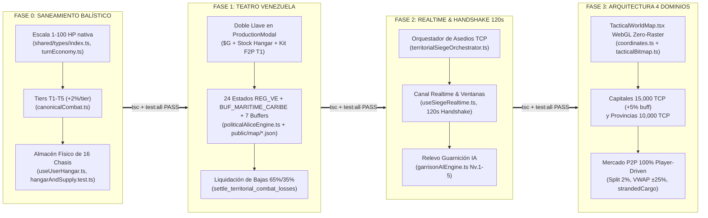

# 🛡️ PLAN HISTÓRICO DE MIGRACIÓN QUIRÚRGICA Y CONSOLIDACIÓN DE DOMINIOS

> **Estado Documental:** Especificación Histórica Archivada — Alineada a **DRONEPUNK 0.0.1**  
> **Proyecto:** **DRONEPUNK** (`0.0.1`)  
> **Código de Documento:** `docs/archive_legacy/MIGRATION_AND_LEGACY_PURGE_PLAN.md`  
> **Documento Rector Padre (SSOT):** `docs/00_GEOTACTICS_ONLINE_MASTER_SPEC.md`  
> **Invariante de Ingeniería:** **Zero-Downtime Migration** (`npx tsc --noEmit` = 0 errores y suites deterministas en verde al cierre de cada etapa).

---

## 1. PROPÓSITO Y PRINCIPIO DE CONTINUIDAD OPERATIVA (ZERO-DOWNTIME MIGRATION)

Este archivo histórico documenta la consolidación arquitectónica de **DRONEPUNK 0.0.1** hacia la arquitectura modular de cuatro dominios (`@domains/world`, `@domains/tactics`, `@domains/economy`, `@domains/game-feel`) y capa compartida (`@shared`), asegurando la convergencia total del código con los **7 Pilares Canónicos**:

1. **Pilar 1 — Almacén Físico de 16 Chasis Militares:** 4 unidades de vanguardia + 12 de reserva en `user_unit_hangar` (munición descartable forjada con stock real y validación por Doble Llave en `src/domains/tactics/components/ProductionModal.tsx`).
2. **Pilar 2 — Combate Determinista `1-100 HP`:** Escala entera continua de `1` a `100 HP` en `src/domains/tactics/core/canonicalCombat.ts` y `src/domains/tactics/core/canonicalDamageChart.ts`.
3. **Pilar 3 — Condición de Derrota Inmediata:** Derrota en el acto al quedar con `0` tropas vivas en la cuadrícula táctica o por captura del Cuartel General (`src/domains/tactics/core/hqCaptureVictory.ts`).
4. **Pilar 4 — Tiers de Manufactura Industrial `T1` a `T5`:** Escalado de `+2%` de efectividad por tier hasta `+8%` máximo en `T5`, con paridad espejo `Tier 1` (`0%` bonificación) en modos competitivos/torneo (`src/domains/tactics/core/rankedLadderEngine.ts`).
5. **Pilar 5 — Teatro Venezuela WebGL Zero-Raster:** 24 entidades soberanas (`REG_VE_01`..`REG_VE_24`) junto a `BUF_MARITIME_CARIBE` (en `public/map/theatre_regions.json`) y 7 zonas buffer fronterizas (`BUF_*` en `src/domains/world/core/politicalAliceEngine.ts`), renderizadas localmente en MapLibre GL v6 (`public/map/theatre_regions.json`, `public/map/theatre_borders_mesh.json`, `public/map/theatre_roads.json`, `public/map/theatre_urban_roads.json`, `public/map/theatre_cities.json`, `public/map/zulia_municipalities.json`, `public/map/world_land.json`), Capitales a `15,000 TCP` con `+5%` de buff regional, provincias estándar a `10,000 TCP` y ventanas de vulnerabilidad contra asaltos offline.
6. **Pilar 6 — Siniestralidad Física y Kit F2P:** Pérdida física de chasis destruidos (`65%` sumidero irreversible + `35%` recuperación en `tech_scrap` mediante `settle_territorial_combat_losses`), respaldada por dotación F2P ilimitada Tier 1 (`infantry` y `recon`).
7. **Pilar 7 — Human Handshake `120s` y Mercado P2P 100% Player-Driven:** Ventana de relevo humano de `120s` (`HUMAN_HANDSHAKE_WINDOW_MS = 120_000`) y Mercado P2P 100% impulsado por jugadores con cargamento varado (`strandedCargo`), comisión dividida del `2%` (`1%` sumidero de quema + `1%` regalía de clan) y collar anti-manipulación VWAP `±25%`.

### 1.1 Las 5 Reglas de Oro de la Transición Sin Ruptura (`Zero-Downtime`)
1. **Desacoplamiento Ordenado (*No Blind Deletes*):** Todo consumidor en `src/App.tsx`, `src/domains/tactics/components/ProductionModal.tsx` y `src/domains/tactics/__tests__/e2eIntegration.test.ts` se migra a los barriles `@domains/*` y `@shared` antes de retirar adaptadores obsoletos.
2. **Patrón *Strangler Fig* en Contratos TypeScript:** Los contratos globales residen en `src/shared/types/index.ts`, `src/shared/types/metagame.ts` y `src/shared/types/database.types.ts` operando nativamente en escala `1-100 HP` y Tiers `T1-T5`.
3. **Invariante de Compilación Continua (`Gatekeeper Check`):** Cada bloque de consolidación valida:
   - `npx tsc --noEmit` (cero errores de tipos en `src/`).
   - `npm run test:all` y `npm run test:geotactics` (suites deterministas en verde).
4. **Preservación de Motores Nucleares:** Se conservan e integran los motores balísticos, de movimiento, niebla de guerra, clima, comandantes, complejo industrial de 10 parcelas y mercado P2P dentro de sus dominios respectivos.
5. **Trazabilidad Histórica en Archivo:** Las especificaciones previas se consolidan en `docs/archive_legacy/` alineadas a **DRONEPUNK 0.0.1** sin referencias rotas.



---

## 2. MATRIZ DOCUMENTAL CONSOLIDADA (`docs/` Y `docs/archive_legacy/`)

Se auditaron y consolidaron los **22 documentos maestros** en `docs/` y los **10 documentos históricos** en `docs/archive_legacy/`, además de los 4 archivos de control en raíz (`README.md`, `CHANGELOG.md`, `task.md`, `walkthrough.md`).

### 2.1 Directorio Principal `docs/` (22 Archivos Activos)

| # | Ruta Real en Disco | Rol en DRONEPUNK 0.0.1 | Estado |
| :--- | :--- | :--- | :--- |
| 1 | `docs/00_GEOTACTICS_ONLINE_MASTER_SPEC.md` | Especificación maestra SSOT de **DRONEPUNK 0.0.1** (7 Pilares Canónicos). | `[ACTIVO - SSOT]` |
| 2 | `docs/00_ARBOL_CANONICO_DE_SISTEMAS_Y_DESARROLLO.md` | Árbol canónico de sistemas de los 4 dominios y capa compartida. | `[ACTIVO]` |
| 3 | `docs/01_MASTER_CARTOGRAPHY_WEBGL_ZERO_RASTER.md` | Especificación de cartografía MapLibre GL v6 Zero-Raster y Semantic Zoom. | `[ACTIVO]` |
| 4 | `docs/02_MASTER_METAGAME_INDUSTRY_ECONOMY.md` | Cadena industrial de 10 parcelas, Almacén Físico de 16 Chasis y Mercado P2P 2%. | `[ACTIVO]` |
| 5 | `docs/03_MASTER_COMMANDERS_BARK_AND_SOCIAL.md` | Sistema de 29 Comandantes, `BarkEngine` y Mayor Stella. | `[ACTIVO]` |
| 6 | `docs/03_TACTICAL_STRATEGY_SYSTEM_DESIGN.md` | Diseño táctico en cuadrícula `1-100 HP`, Tiers `T1-T5` y captura de HQ. | `[ACTIVO]` |
| 7 | `docs/04_MASTER_DATABASE_AND_SECURITY_SPEC.md` | Esquema PostgreSQL Supabase, RLS y 32 migraciones SQL. | `[ACTIVO]` |
| 8 | `docs/05_MASTER_GAME_ENGINE_AND_NETWORKING.md` | Motores de combate, turnos, Realtime y sincronización de partidas. | `[ACTIVO]` |
| 9 | `docs/06_MASTER_DEVOPS_QA_AND_TELEMETRY.md` | Oráculos deterministas, QA E2E Playwright y telemetría. | `[ACTIVO]` |
| 10 | `docs/07_MASTER_UI_UX_WAR_ROOM.md` | Consola C4ISR, física de resortes, Ghost Bars y audio Web Audio API. | `[ACTIVO]` |
| 11 | `docs/README.md` | Índice navegable de la documentación técnica. | `[ACTIVO]` |
| 12 | `docs/ANALISIS_PROJECT_ALICE_RUTAS_INGENIERIA_MAPA_METAPOLITICA.md` | Análisis de grafos viales, logística y metapolítica del Teatro Venezuela. | `[ACTIVO]` |
| 13 | `docs/ARQUITECTURA_FEUDOS_CADENA_INDUSTRIAL_ALICE_ALBION.md` | Arquitectura de feudos, RGOs y cadena industrial de 10 parcelas. | `[ACTIVO]` |
| 14 | `docs/AUDITORIA_DISCREPANCIAS_V0.0.2_ALFA.md` | Registro histórico de cierre de discrepancias consolidado a `0.0.1`. | `[ACTIVO]` |
| 15 | `docs/AUDIT_STARTUP_UI_UX_AND_WINDOW_ORCHESTRATION.md` | Auditoría de arranque, orquestación de ventanas y renderizado. | `[ACTIVO]` |
| 16 | `docs/DATABASE_ARCHITECTURE_AUDIT.md` | Auditoría de esquema SQL, RPCs atómicas y paridad de tipos. | `[ACTIVO]` |
| 17 | `docs/DIAGNOSTICO_META_Y_ROADMAP_BETA.md` | Diagnóstico de metajuego y hoja de ruta operativa. | `[ACTIVO]` |
| 18 | `docs/MASTER_MVP_BLUEPRINT_AND_ROADMAP.md` | Blueprint del MVP sobre el Teatro Venezuela y 4 dominios. | `[ACTIVO]` |
| 19 | `docs/PLAN_IMPLEMENTACION_FEUDOS_CADENA_INDUSTRIAL.md` | Plan de implementación de parcelas industriales e infraestructura. | `[ACTIVO]` |
| 20 | `docs/PROPUESTA_INGENIERIA_MAPA_METAPOLITICA_ALICE_CABIMAS.md` | Ingeniería municipal de Zulia y metapolítica espacial. | `[ACTIVO]` |
| 21 | `docs/PROPUESTA_INTEGRACION_SISTEMA_POLITICO_PROJECT_ALICE.md` | Integración del motor político `politicalAliceEngine.ts`. | `[ACTIVO]` |
| 22 | `docs/VIABILITY_REPORT_GAMEPLAY_TICKS_LOGISTICS.md` | Reporte de viabilidad de ticks económicos y líneas logísticas. | `[ACTIVO]` |

### 2.2 Subdirectorio `docs/archive_legacy/` (10 Especificaciones Históricas Archivadas)

| # | Ruta Real en Disco | Rol Histórico Archivado |
| :--- | :--- | :--- |
| 1 | `docs/archive_legacy/ANALISIS_ARQUITECTURA_GEOTACTICS.md` | Análisis inicial de integración entre lienzo territorial y motor geopolítico. |
| 2 | `docs/archive_legacy/FASE_2_DESPLIEGUE_LOCAL_MASTER_PLAN.md` | Plan histórico de aprovisionamiento local con Supabase (32 migraciones) y Vite. |
| 3 | `docs/archive_legacy/MIGRATION_AND_LEGACY_PURGE_PLAN.md` | Este plan histórico de migración hacia la arquitectura modular de 4 dominios. |
| 4 | `docs/archive_legacy/ORQUESTACION_SISTEMA_E2E_PLAYTEST_QA_MULTIMODAL.md` | Diseño de pruebas E2E con Playwright y puente `src/shared/utils/qaHarness.ts`. |
| 5 | `docs/archive_legacy/PLAN_DESPLIEGUE_MAPA_WEBGL_VENEZUELA.md` | Despliegue del mapa WebGL Zero-Raster sobre las 24 entidades de Venezuela y buffers. |
| 6 | `docs/archive_legacy/PLAN_IMPLEMENTACION_MAPA_VECTORIAL_ZERO_RASTER.md` | Migración desde tiles raster externos hacia vector local en GPU. |
| 7 | `docs/archive_legacy/PLAN_MAESTRO_REESTRUCTURACION_HEGEMONIA.md` | Especificación de convergencia hacia escala `1-100 HP`, Doble Llave y asedios TCP. |
| 8 | `docs/archive_legacy/UI_UX_AUDIT_REPORT.md` | Línea base de auditoría visual y accesibilidad C4ISR. |
| 9 | `docs/archive_legacy/UI_UX_RESTRUCTURE_BLUEPRINT.md` | Blueprint de reestructuración de consola War-Room y Audio Procedural. |
| 10 | `docs/archive_legacy/WARERA_MAP_ARCHITECTURE_DEEP_DIVE.md` | Estudio técnico del pipeline TopoJSON, `feature-state` en GPU y shaders WebGL. |

---

## 3. MATRIZ CONSOLIDADA DE CÓDIGO FUENTE (`src/` Y `supabase/`)

### 3.1 Capa Compartida (`src/shared/`) y Orquestadores Raíz (`src/App.tsx`, `src/docsData.ts`)

| Ruta Real en Disco | Contratos / Módulos Consolidados | Estado Canónico en DRONEPUNK 0.0.1 |
| :--- | :--- | :--- |
| `src/shared/types/index.ts` | `TacticalUnit`, `PlayerProfile`, `TerrainTile` | Escala entera continua `1-100 HP` (`maxHp: 100`) y `tier: 1..5`. |
| `src/shared/types/metagame.ts` | `MASTER_METAGAME_CONSTANTS`, `GeotacticsRegion`, `TerritorialBattleSession` | `HANDSHAKE_TIMEOUT_SECONDS = 120`, `CAPITAL_TCP_THRESHOLD = 15000`, `STANDARD_TCP_THRESHOLD = 10000`, `TOTAL_P2P_TAX_RATE = 0.02`, `VWAP_COLLAR_PERCENT = 0.25`, `RECYCLE_SCRAP_RATE = 0.35`. |
| `src/shared/types/database.types.ts` | `Database` | Contratos tipados sincronizados con PostgreSQL Supabase. |
| `src/shared/utils/qaHarness.ts` | `initQABridge`, `updateQASnapshot`, `QAGameSnapshot` | Puente de telemetría QA para Playwright (`window.__TACTICAL_QA_BRIDGE__`). |
| `src/docsData.ts` | `DOCS_DATA` | Visor interno sincronizado con la documentación de **DRONEPUNK 0.0.1**. |
| `src/App.tsx` | `App` | Orquestador raíz conectado a `@domains/world`, `@domains/tactics`, `@domains/economy`, `@domains/game-feel` y `@shared`. |

### 3.2 Dominio Tactics (`src/domains/tactics/`)

| Ruta Real en Disco | Símbolos Clave | Responsabilidad Consolidada |
| :--- | :--- | :--- |
| `src/domains/tactics/core/canonicalCombat.ts` | `CanonicalCombatEngine`, `CanonicalCombatOptions` | Combate determinista continuo `1-100 HP` con bonificación de Tiers `T1-T5` (`+2%` por nivel, max `+8%` en `T5`) y paridad `Tier 1` (`0%`) en torneo/ranked. |
| `src/domains/tactics/core/canonicalDamageChart.ts` | `CANONICAL_DAMAGE_CHART`, `getCanonicalBaseDamage` | Matriz balística base determinista entre clases de unidades. |
| `src/domains/tactics/core/combat.ts` | `CombatEngine` | Resolución de daño, contraataque y captura de propiedades en 2 turnos a salud completa. |
| `src/domains/tactics/core/hqCaptureVictory.ts` | `executeHqCaptureElimination` | Derrota inmediata por captura de HQ o eliminación total (`0` tropas vivas). |
| `src/domains/tactics/core/autonomousOrchestrator.ts` | `AutonomousTurnOrchestrator` | Simulaciones y gestión de turnos en escala `1-100 HP`. |
| `src/domains/tactics/core/mapImporter.ts` | `parseAWBWMap`, `parseAWBWExtendedMap` | Importación de mapas tácticos con unidades inicializadas a `100 HP`. |
| `src/domains/tactics/core/tutorialEngine.ts` | Tutorial interactivo | Instanciación de tropas de práctica en escala `1-100 HP`. |
| `src/domains/tactics/core/garrisonAIEngine.ts` | `GarrisonAIEngine` | Guarnición IA autónoma de 5 niveles cognitivos tras expirar el Handshake de `120s`. |
| `src/domains/tactics/core/tacticalCombatSeamlessIntegration.ts` | `settleCombatLossesAndScrap`, `evaluateDefensiveHandshake` | Puente entre combate táctico, liquidación física y Handshake defensivo. |
| `src/domains/tactics/components/ProductionModal.tsx` | `ProductionModal` | Despliegue con Doble Llave (`$G` in-match + Almacén Físico de 16 Chasis + kit F2P ilimitado `infantry` / `recon` Tier 1). |
| `src/domains/tactics/components/GameCanvas.tsx` | `GameCanvas` | Renderizado de cuadrícula táctica con barras de integridad `1-100 HP`. |

### 3.3 Dominio World (`src/domains/world/`)

| Ruta Real en Disco | Símbolos Clave | Responsabilidad Consolidada |
| :--- | :--- | :--- |
| `src/domains/world/components/TacticalWorldMap.tsx` | `TacticalWorldMap` | Motor cartográfico MapLibre GL v6 WebGL Zero-Raster con Semantic LOD y consumo local de `public/map/*.json`. |
| `src/domains/world/core/coordinates.ts` | `ZOOM_GLOBAL`, `ZOOM_OPERACIONAL`, `ZOOM_TACTICO`, `lngLatToGridCoords`, `traceSupplyLine` | Proyección WGS84 O(1) y trazado Bresenham de líneas de suministro. |
| `src/domains/world/core/tacticalBitmap.ts` | `TacticalBitMap` | Empaquetado binario de niebla de guerra en `Uint8Array` (50 bytes). |
| `src/domains/world/core/politicalAliceEngine.ts` | `CANONICAL_VENEZUELA_REGIONS`, `CANONICAL_VENEZUELA_ADJACENCIES` | 24 estados soberanos `REG_VE_01`..`REG_VE_24`, 7 zonas buffer `BUF_*` y estratos provinciales. |
| `src/domains/world/core/territorialSiegeOrchestrator.ts` | `TerritorialSiegeOrchestrator`, `VulnerabilityWindowConfig` | Orquestador de asedios TCP (`15,000` capitales con `+5%` buff regional, `10,000` estándar), ventanas de vulnerabilidad y Handshake de `120s`. |
| `src/domains/world/index.ts` | `HUMAN_HANDSHAKE_WINDOW_MS` | Barril público `@domains/world` con ventana canónica de `120_000` ms. |
| `src/domains/world/components/TerritorySiegeModal.tsx` | `TerritorySiegeModal` | Modal de briefing pre-asedio y cuenta atrás de relevo humano `120s`. |
| `src/domains/world/hooks/useSiegeRealtime.ts` | `useSiegeRealtime` | Suscripción Realtime a alertas defensivas por región. |
| `src/domains/world/hooks/useTerritoryMap.ts` | `useTerritoryMap` | Sincronización de estado territorial sobre `TacticalWorldMap.tsx`. |

### 3.4 Dominio Economy (`src/domains/economy/`) & Dominio Game-Feel (`src/domains/game-feel/`)

| Ruta Real en Disco | Símbolos Clave | Responsabilidad Consolidada |
| :--- | :--- | :--- |
| `src/domains/economy/core/turnEconomy.ts` | `TurnEconomyEngine`, `CANONICAL_UNIT_PRODUCTION_CATALOG` | Producción a `100 HP`, reparaciones hasta `+20 HP` por turno y derrota inmediata al perder todas las unidades. |
| `src/domains/economy/core/industrialEngine.ts` | `IndustrialEngine`, `StrandedCargo`, `P2PMarketListing` | 10 parcelas por feudo, `strandedCargo`, Mercado P2P 100% impulsado por jugadores (`2%` = `1%` quema + `1%` clan, VWAP `±25%`). |
| `src/domains/economy/components/LoadoutCustomizer.tsx` | `LoadoutCustomizer` | Personalizador de camuflajes y chasis de despliegue en escala `100 HP`. |
| `src/domains/economy/components/P2PMarketplaceView.tsx` | `P2PMarketplaceView` | Terminal del Mercado Libre P2P entre jugadores. |
| `src/domains/economy/hooks/useUserHangar.ts` | `useUserHangar` | Lectura y descuento del Almacén Físico de 16 Chasis (`user_unit_hangar`). |
| `src/domains/economy/__tests__/hangarAndSupply.test.ts` | Suite de hangar y suministro | Verificación determinista de Doble Llave, kit F2P ilimitado y unidades `100 HP`. |
| `src/domains/game-feel/core/audioManager.ts` | `audioManager` | Síntesis Web Audio API con `pitchShift` y feedback táctil. |
| `src/domains/game-feel/core/barkEngine.ts` | `barkEngine` | Motor de diálogos de comandantes con bucle de telemetría. |

### 3.5 Esquema SQL y 32 Migraciones (`supabase/migrations/`)

| Artefacto SQL Real en Disco | Alcance Histórico Consolidado |
| :--- | :--- |
| `supabase/migrations/20261024000001_initial_schema.sql` .. `20261031000022_reconnection_snapshots_and_full_catalog.sql` | 22 migraciones fundacionales preservadas para replay secuencial limpio de Postgres. |
| `supabase/migrations/20261103000001_master_metagame_v2_rework.sql` .. `20261103000003_v2_canonical_consolidation.sql` | Tablas soberanas `world_countries`, `world_provinces`, `territory_nodes`, `territory_adjacencies`, `territory_control`, `corporate_subsidiaries`, `user_unit_hangar`, `user_patents`, `garrison_deployments`, `p2p_market_orders` y tope corporativo de 10 clanes. |
| `supabase/migrations/20261104000001_geotactics_alpha_siege_and_venezuela_seed.sql` | Tablas `regions`, `region_adjacencies`, `region_sovereignty`, `territorial_battle_sessions`, RPC `settle_territorial_combat_losses` (65% sumidero + 35% `tech_scrap`) y seed de las 24 entidades de Venezuela + 7 buffers. |
| `supabase/migrations/20261105000001_geotactics_strategic_nodes_and_queues.sql` .. `20261110_fix_database_audit_regressions.sql` | Nodos estratégicos, RBAC de soberanía (`20261106_state_sovereignty_rbac.sql`), tiempo real municipal (`20261107_theatre_cabimas_realtime.sql`), manifiesto (`20261108_system_catalog_manifest.sql`), ventanas de vulnerabilidad (`20261109_territorial_vulnerability_windows.sql`) y remediación de auditoría (`20261110_fix_database_audit_regressions.sql`) — completando **32 migraciones** y `supabase/CONSOLIDATED_FULL_DATABASE_DEPLOY.sql`. |

---

## 4. PROTOCOLO HISTÓRICO DE EJECUCIÓN EN 4 FASES Y CHECKLIST QA

### 4.1 FASE 0: Escala `1-100 HP` Nativa, Tiers `T1-T5` y Almacén Físico de 16 Chasis
- Todo motor de combate y economía opera nativamente en escala entera `1-100 HP` (`src/domains/tactics/core/canonicalCombat.ts`, `src/domains/economy/core/turnEconomy.ts`).
- Los modificadores de calidad utilizan exclusivamente Tiers industriales `T1` a `T5` (`+2%` por nivel hasta `+8%` en `T5`), con paridad `Tier 1` (`0%`) en modos competitivos/ranked.
- El Almacén Físico de 16 Chasis Militares (`4` vanguardia + `12` reserva en `user_unit_hangar`) reemplaza cualquier selector estático previo.

### 4.2 FASE 1: Teatro Venezuela (24 Estados + `BUF_MARITIME_CARIBE` + 7 Buffers), Doble Llave y Bajas Reales
- Sembrado de las 24 entidades soberanas (`REG_VE_01`..`REG_VE_24`) con **Caracas (`REG_VE_01`)** a `15,000 TCP` (+5% buff regional), provincias estándar a `10,000 TCP`, `BUF_MARITIME_CARIBE` en `public/map/theatre_regions.json` y 7 buffers fronterizos `BUF_*` en `src/domains/world/core/politicalAliceEngine.ts`.
- Despliegue por Doble Llave Material en `src/domains/tactics/components/ProductionModal.tsx` usando `src/domains/economy/hooks/useUserHangar.ts` y kit F2P ilimitado `infantry` + `recon` Tier 1.
- Liquidación atómica de bajas físicas vía `settle_territorial_combat_losses` (`65%` sumidero irreversible + `35%` `tech_scrap`).

### 4.3 FASE 2: Red Realtime, Ventanas de Vulnerabilidad y Human Handshake (`120s`)
- Alertas en vivo mediante `src/domains/world/hooks/useSiegeRealtime.ts` dentro de ventanas de vulnerabilidad (`supabase/migrations/20261109_territorial_vulnerability_windows.sql`).
- Orquestación de `120s` (`HUMAN_HANDSHAKE_WINDOW_MS = 120_000`) en `src/domains/world/core/territorialSiegeOrchestrator.ts` con transición a Guarnición IA (`src/domains/tactics/core/garrisonAIEngine.ts`) si expira sin relevo humano.

### 4.4 FASE 3: WebGL Zero-Raster y Mercado P2P 100% Player-Driven
- Renderizado local Zero-Raster en `src/domains/world/components/TacticalWorldMap.tsx` sobre `public/map/*.json` con tres niveles LOD (`ZOOM_GLOBAL = 3.5`, `ZOOM_OPERACIONAL = 10.0`, `ZOOM_TACTICO = 15.0`) y `TacticalBitMap` (50 bytes).
- Mercado P2P 100% impulsado por jugadores en `src/domains/economy/core/industrialEngine.ts` y `src/domains/economy/components/P2PMarketplaceView.tsx` con `strandedCargo`, split del `2%` (`1%` quema + `1%` regalía de clan) y collar VWAP `±25%`.

### 4.5 Checklist de Verificación Automatizada (Gatekeeper QA)

```powershell
# 1. Compilación estricta de TypeScript
npx tsc --noEmit

# 2. Suites deterministas completas de los 4 dominios
npm run test:all
npm run test:geotactics

# 3. Suite cartográfica topológica Zero-Raster
npm run test:cartography

# 4. Playtesting E2E en Chromium (Playwright)
npm run test:qa
```

---
*Especificación Histórica Archivada — Alineada a **DRONEPUNK 0.0.1**.*
