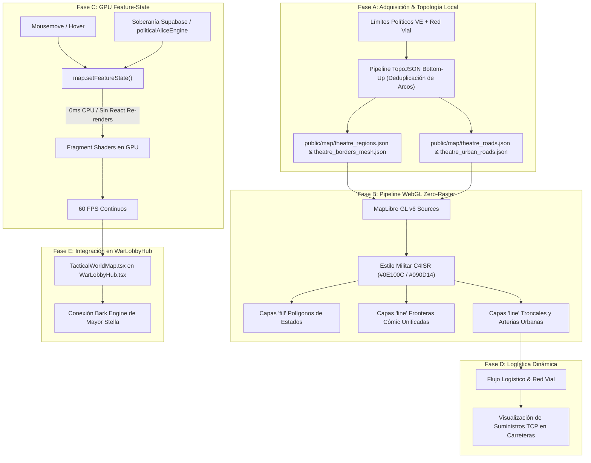

# Plan Maestro de Despliegue: Cartografía Geográfica Vectorial WebGL 2.0 para Venezuela
## Lienzo Táctico C4ISR Zero-Raster para DRONEPUNK 0.0.1

---

> **Estado Documental:** Especificación Histórica Archivada — Alineada a **DRONEPUNK 0.0.1**  
> **Documento:** `docs/archive_legacy/PLAN_DESPLIEGUE_MAPA_WEBGL_VENEZUELA.md`  
> **Proyecto / Versión:** **DRONEPUNK 0.0.1**  
> **Arquitectura Base:** MapLibre GL v6 (WebGL 2.0) + Topología Vectorial Local (`public/map/*.json`) + `feature-state` en GPU  
> **Área Cartográfica:** República de Venezuela (24 Entidades Soberanas `REG_VE_01`..`REG_VE_24` + `BUF_MARITIME_CARIBE` + 7 Zonas Buffer Fronterizas `BUF_*`)  
> **Rendimiento Objetivo:** 60 FPS estables • 0ms CPU Overhead en Hover/Selección • Cero peticiones a servidores raster externos

---

## 1. Diagnóstico y Estado Consolidado del Sistema

### 1.1 Arquitectura de Renderizado Cartográfico

| Componente | Motor de Render | Representación Espacial | Estado de Interactividad | Situación en DRONEPUNK 0.0.1 |
| :--- | :--- | :--- | :--- | :--- |
| **`src/domains/world/components/TacticalWorldMap.tsx`** | MapLibre GL v6 (WebGL 2.0) Zero-Raster | Proyección WGS84 con geometrías vectoriales locales (`public/map/world_land.json`, `public/map/theatre_regions.json`, `public/map/theatre_borders_mesh.json`, `public/map/theatre_roads.json`, `public/map/theatre_urban_roads.json`, `public/map/theatre_cities.json`, `public/map/zulia_municipalities.json`) sobre fondo `#0E100C`. | Escucha eventos de MapLibre a 60 FPS con `feature-state` en GPU y referencias estables. | **Zero-Raster Local Logrado**: Cero llamadas a proveedores externos. Carreteras troncales, arterias urbanas y polígonos procesados en GPU. |
| **`src/domains/world/components/WarLobbyHub.tsx`** | Shell C4ISR Unificado | Renderiza `TacticalWorldMap` como teatro estratégico persistente del lobby (`webgl`). | Selección directa de estados, municipios de Zulia y celdas tácticas sin desmontar el HQ. | Operativo como consola maestra de mando en `DRONEPUNK 0.0.1`. |

### 1.2 Análisis del Pipeline de Datos y Coordenadas (`useTerritoryMap.ts` y `coordinates.ts`)
1. **Regiones en `src/domains/world/core/politicalAliceEngine.ts`:**
   Las 24 entidades soberanas (`REG_VE_01` a `REG_VE_24`) y las 7 zonas buffer fronterizas (`BUF_CO_01..03`, `BUF_BR_01`, `BUF_GY_01`, `BUF_TT_01`, `BUF_CW_01`), complementadas con `BUF_MARITIME_CARIBE` en `public/map/theatre_regions.json`, estructuran la topología geopolítica y de adyacencias del Teatro Venezuela.
2. **Coordenadas Geográficas Reales y Encuadre:**
   El centroide geográfico de la República de Venezuela (`[lng: -66.5897, lat: 6.4238]`) abarca simultáneamente:
   - Toda la fachada marítima caribeña (`BUF_MARITIME_CARIBE`, Golfo de Venezuela, Nueva Esparta).
   - El eje central, industrial y llanero (Caracas, Valencia, Maracay, Barinas, Apure).
   - El macizo guayanés y la Zona en Reclamación (Bolívar, Amazonas, Guayana Esequiba).
   - Los chokepoints fronterizos y marítimos críticos con Colombia, Brasil, Guyana, Trinidad & Tobago y Antillas Neerlandesas.
3. **Resolución Cartográfica Topológica (`public/map/`):**
   El pipeline TopoJSON Bottom-Up (`scripts/verify-map-topology.mjs`) garantiza devanado coherente e igualdad exacta (`0.000 m` de desfase) entre los 24 estados (`theatre_regions.json`), la malla de fronteras (`theatre_borders_mesh.json`), los 21 municipios de Zulia (`zulia_municipalities.json`) y la masa continental (`world_land.json`).

---

## 2. Hoja de Ruta Histórica Consolidada en 5 Fases



---

### Fase A: Adquisición y Optimización Cartográfica Zero-Raster
- **Objetivo**: Proveer la geometría canónica de Venezuela de alta fidelidad sin depender de servicios de terceros ni API keys.
- **Artefactos Locales Canónicos en `public/map/`:**
  - `public/map/theatre_regions.json` (24 entidades `REG_VE_01`..`REG_VE_24` + `BUF_MARITIME_CARIBE`).
  - `public/map/theatre_borders_mesh.json` (aristas únicas de frontera estatal sin duplicados).
  - `public/map/theatre_roads.json` y `public/map/theatre_urban_roads.json` (red vial troncal y vialidad urbana).
  - `public/map/theatre_cities.json`, `public/map/zulia_municipalities.json` (21 municipios `MUN_ZULIA_*`) y `public/map/world_land.json`.

---

### Fase B: Pipeline WebGL Zero-Raster y Estilo Militar C4ISR
- **Objetivo**: Renderizar el mapa 100% en cliente con shaders WebGL, sin llamadas a basemaps raster externos.
- **Paleta Canónica C4ISR de Fondo y Terreno**:
  - `ocean-deep`: `#06080D` (Aguas internacionales y fondo vacío del canvas).
  - `ocean-coastal`: `#090D14` (Plataforma continental y mar territorial de la ZEE venezolana).
  - `land-background`: `#0F141C` (Masa continental base de Suramérica).
  - `state-fill-default`: `rgba(22, 28, 38, 0.75)` (Estado neutral o no capturado).
  - `border-comic-outer`: `#0A0B08` con grosor `2.5px` (Estilo contorno cómic grueso de novela gráfica bélica).
  - `border-comic-inner`: `#46521F` con grosor `1.0px` (División interestatal interna).
- **Jerarquía Vectorial de la Red Vial y Fluvial**:
  1. *Autopistas y Troncales Primarias*: `#F59E0B` (Ámbar táctico militar), `2.0px`.
  2. *Troncales Secundarias y Ramales*: `#78716C` (Gris acero táctico), `1.0px`.
  3. *Eje Fluvial Navegable*: `#38BDF8` (Cian fluvial), `1.5px` con patrón punteado.
  4. *Corredores Marítimos Caribeños*: `#0284C7` (Azul ultramarino), `1.2px` con patrón espaciado.

---

### Fase C: Interactividad en GPU sin Re-renders (`feature-state`)
- **Objetivo**: Evitar re-renders del árbol React en `mousemove` delegando hover, selección y estado de asedio al `feature-state` de MapLibre GL v6.
- **Implementación del Shader `case` en MapLibre GL**:
  ```json
  "fill-color": [
    "case",
    ["boolean", ["feature-state", "selected"], false],
    "#FACC15",
    ["boolean", ["feature-state", "hover"], false],
    "rgba(250, 204, 21, 0.35)",
    ["boolean", ["feature-state", "underSiege"], false],
    "#DC2626",
    ["string", ["feature-state", "clanColor"], "#1E293B"]
  ],
  "fill-opacity": [
    "case",
    ["boolean", ["feature-state", "selected"], false],
    0.85,
    ["boolean", ["feature-state", "hover"], false],
    0.70,
    0.50
  ]
  ```
- **Sincronización con Supabase Realtime**:
  Al recibir un evento de cambio de soberanía (`15,000 TCP` en capitales con `+5%` buff regional, `10,000 TCP` en provincias estándar, o ventanas de vulnerabilidad contra asaltos offline), `src/domains/world/hooks/useTerritoryMap.ts` y `src/domains/world/hooks/useSiegeRealtime.ts` actualizan el estado de la región directamente en GPU.

---

### Fase D: Carreteras y Logística Dinámica de Suministros
- **Objetivo**: Reflejar el tráfico de convoyes y la conectividad logística (`src/domains/world/core/roadNetworkEngine.ts`, `src/domains/world/core/spatialRoadIndex.ts`) entre regiones conectadas.
- Si una región aliada queda aislada por un asedio o bloqueo vial, la conectividad de la línea de suministro (`validateSupplyLineConnectivity` en `src/domains/world/core/worldMapEngine.ts`) marca la ruptura en tiempo real.

---

### Fase E: Integración Definitiva en `src/domains/world/components/WarLobbyHub.tsx`
- **Objetivo**: Establecer `src/domains/world/components/TacticalWorldMap.tsx` como el renderizador cartográfico único e ininterrumpido del Lobby Bélico.
- **Acciones Consolidadas**:
  1. Renderizado WebGL Zero-Raster como vista principal permanente.
  2. Vinculación con `src/domains/world/components/TerritoryInspectorModal.tsx` y `src/domains/world/components/UnifiedRegionInspector.tsx`.
  3. Disparo de respuestas diegéticas mediante `src/domains/game-feel/core/barkEngine.ts` y `src/domains/game-feel/components/CommanderBarkWidget.tsx`.

---

## 3. Matriz de Cobertura Cartográfica: 24 Entidades Soberanas de Venezuela (`CANONICAL_VENEZUELA_REGIONS`) y Buffers

| Código de Región | Entidad Federal / Zona | Capital / Nodo Estratégico | Bioma Táctico | Recurso Primario / Rol |
| :--- | :--- | :--- | :--- | :--- |
| `REG_VE_01` | **Distrito Capital - Caracas** | Caracas (Capital Nacional Conquistable — 15,000 TCP, +5% Buff Regional) | Urbano (`BIO-URB`) | `petroquimica_fina` |
| `REG_VE_02` | **Zulia - Maracaibo** | Maracaibo (Chokepoint Lacustre + 21 municipios en `zulia_municipalities.json`) | Planicie (`BIO-PLA`) | `crudo_ligero` |
| `REG_VE_03` | **Bolívar - Ciudad Guayana** | Ciudad Guayana / Sidor | Tierras Altas (`BIO-HGH`) | `hierro_bauxita` |
| `REG_VE_04` | **Anzoátegui - Barcelona/PLC** | Barcelona / Puerto La Cruz | Planicie (`BIO-PLA`) | `crudo_pesado` |
| `REG_VE_05` | **Carabobo - Valencia/Pto. Cabello** | Valencia / Puerto Cabello | Urbano (`BIO-URB`) | `ensamblaje_mec` |
| `REG_VE_06` | **Miranda - Valles del Tuy** | Valles del Tuy / Los Teques | Planicie (`BIO-PLA`) | `manufactura_ligera` |
| `REG_VE_07` | **Lara - Barquisimeto** | Barquisimeto | Planicie (`BIO-PLA`) | `nudo_ferroviario` |
| `REG_VE_08` | **Aragua - Maracay** | Maracay | Urbano (`BIO-URB`) | `blindaje_aereo` |
| `REG_VE_09` | **Táchira - San Cristóbal** | San Cristóbal | Tierras Altas (`BIO-HGH`) | `carbon_aduanero` |
| `REG_VE_10` | **Mérida - Cordillera Andina** | Mérida | Tierras Altas (`BIO-HGH`) | `silicio_optico` |
| `REG_VE_11` | **Falcón - Paraguaná** | Coro / Punto Fijo | Planicie (`BIO-PLA`) | `refinacion_crp` |
| `REG_VE_12` | **Monagas - Maturín** | Maturín | Planicie (`BIO-PLA`) | `gas_natural` |
| `REG_VE_13` | **Sucre - Cumaná/Golfo de Paria** | Cumaná / Chokepoint Golfo de Paria | Costero/Insular (`BIO-ARC-ISL`) | `astillero_naval` |
| `REG_VE_14` | **Nueva Esparta - Margarita** | Porlamar / La Asunción | Insular (`BIO-ARC-ISL`) | `radar_zonafranca` |
| `REG_VE_15` | **Barinas - Llanos Altos** | Barinas | Planicie (`BIO-PLA`) | `agropecuaria_crudo` |
| `REG_VE_16` | **Portuguesa - Acarigua** | Acarigua | Planicie (`BIO-PLA`) | `biocombustibles` |
| `REG_VE_17` | **Guárico - Calabozo/San Juan** | San Juan de los Morros / Calabozo | Planicie (`BIO-PLA`) | `satelital_canteras` |
| `REG_VE_18` | **Trujillo - Andes Centrales** | Trujillo / Valera | Tierras Altas (`BIO-HGH`) | `silice_cemento` |
| `REG_VE_19` | **Yaracuy - San Felipe** | San Felipe | Planicie (`BIO-PLA`) | `cobre_fertilizantes` |
| `REG_VE_20` | **Cojedes - San Carlos** | San Carlos | Planicie (`BIO-PLA`) | `pastizales_roca` |
| `REG_VE_21` | **Apure - San Fernando** | San Fernando de Apure | Planicie (`BIO-PLA`) | `eje_fluvial` |
| `REG_VE_22` | **Delta Amacuro - Caños Orinoco** | Tucupita | Deltáico/Insular (`BIO-ARC-ISL`) | `bauxita_delta` |
| `REG_VE_23` | **Amazonas - Puerto Ayacucho** | Puerto Ayacucho | Selva (`BIO-JGL`) | `tierras_raras` |
| `REG_VE_24` | **Guayana Esequiba - Zona Reclamación** | Zona en Reclamación | Selva (`BIO-JGL`) | `oro_diamantes` |
| `BUF_MARITIME_CARIBE` | **Buffer Marítimo Caribe** | Fachada Marítima Caribeña (`public/map/theatre_regions.json`) | Marítimo | Zona de amortiguación marítima |
| `BUF_CO_01..03`, `BUF_BR_01`, `BUF_GY_01`, `BUF_TT_01`, `BUF_CW_01` | **7 Zonas Buffer Fronterizas** | Cúcuta, La Guajira, Arauca, Roraima, Demerara, Trinidad & Tobago, Antillas Neerlandesas (`src/domains/world/core/politicalAliceEngine.ts`) | Varios | Amortiguación fronteriza (`isPlayable: false`) |

---

## 4. Bucle de Verificación y Criterios de Aceptación (DoD)

1. **Aislamiento Zero-Raster**: Cero llamadas de red a URLs externas de mapas (`cartodb.com`, `mapbox.com`, `tile.openstreetmap.org`). El 100% de los datos cartográficos se sirve localmente desde `public/map/*.json`.
2. **Presupuesto de Rendimiento**:
   - Inicialización del mapa en frío: < 150 ms en Chromium.
   - Consumo de CPU en standby (sin movimiento): 0% CPU.
   - Framerate durante pan/zoom: 60 FPS estables.
3. **Integridad de Contratos de Tipos**:
   - Cumplimiento estricto con `src/domains/world/types/mapSelectionTypes.ts`, `src/domains/world/types/tacticalRoadTypes.ts`, `src/domains/world/types/stateSovereigntyTypes.ts` y `src/shared/types/metagame.ts` (`WorldProvince`, `TerritoryControlState`, `GeotacticsRegion`).
4. **Resonancia de Game Feel y Sonido**:
   - Cada interacción en el mapa emite respuesta háptica (`src/domains/game-feel/core/hapticFeedback.ts`), sonido de consola (`src/domains/game-feel/core/audioManager.ts`) y eventos de `BarkEngine` (`src/domains/game-feel/core/barkEngine.ts`).

---
*Especificación Histórica Archivada — Alineada a **DRONEPUNK 0.0.1**.*
