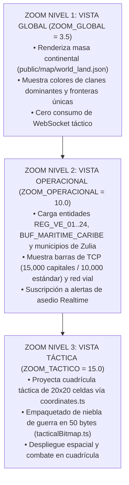

# 🏛️ PLAN HISTÓRICO DE REESTRUCTURACIÓN INTEGRAL: PROYECTO HEGEMONÍA
## *Transición Arquitectónica hacia el Núcleo MMORTS de Soberanía Territorial de DRONEPUNK 0.0.1*

> **Estado Documental:** Especificación Histórica Archivada — Alineada a **DRONEPUNK 0.0.1**  
> **Documento:** `docs/archive_legacy/PLAN_MAESTRO_REESTRUCTURACION_HEGEMONIA.md`  
> **Versión:** `DRONEPUNK 0.0.1`  
> **Alineación:** Integración histórica con `docs/00_ARBOL_CANONICO_DE_SISTEMAS_Y_DESARROLLO.md` y `docs/00_GEOTACTICS_ONLINE_MASTER_SPEC.md`.  
> **Propósito:** Documentar el diseño de ingeniería de software, arquitectura de sistemas y reglas de juego que consolidaron el código en los 4 dominios de **DRONEPUNK 0.0.1** (`@domains/world`, `@domains/tactics`, `@domains/economy`, `@domains/game-feel`) y `@shared`.

---

# 1. VISIÓN DEL PRODUCTO Y ANÁLISIS DE BRECHA HISTÓRICO (GAP ANALYSIS)

### 1.1 El High Concept Unificado en DRONEPUNK 0.0.1
**DRONEPUNK 0.0.1** articula la guerra territorial persistente mediante tres capas acopladas y deterministas:
1. **La Capa Superior (Geopolítica / `@domains/world`):** Clanes y corporaciones disputan regiones soberanas en el Teatro Venezuela (24 estados `REG_VE_01`..`REG_VE_24` + `BUF_MARITIME_CARIBE` + 7 zonas buffer fronterizas `BUF_*` en `src/domains/world/core/politicalAliceEngine.ts`), cobran peajes en pasos estratégicos y conquistan la Capital (`15,000 TCP`) para proyectar un buff regional del `+5%`, respetando ventanas de vulnerabilidad contra asaltos offline.
2. **La Capa Media (Economía / `@domains/economy`):** Toda unidad avanzada se forja físicamente mediante 10 parcelas industriales por feudo (`src/domains/economy/core/industrialEngine.ts`), se almacena en el **Almacén Físico de 16 Chasis Militares** (4 de vanguardia + 12 de reserva en `user_unit_hangar`, munición descartable forjada) o se negocia en un Mercado P2P **100% impulsado por jugadores** con cargamento varado (`strandedCargo`), comisión dividida del **2%** (`1%` sumidero de quema + `1%` regalía de clan) y collar VWAP `±25%`.
3. **La Capa Inferior (Combate / `@domains/tactics`):** Las batallas tácticas se ejecutan en escala entera continua `1-100 HP` determinista (`src/domains/tactics/core/canonicalCombat.ts`, `src/domains/tactics/core/canonicalDamageChart.ts`), con derrota inmediata al quedar con 0 tropas vivas o captura del Cuartel General (`src/domains/tactics/core/hqCaptureVictory.ts`), Tiers de manufactura industrial `T1` a `T5` (`+2%` por tier, hasta `+8%` en `T5`; paridad espejo Tier 1 `0%` en torneo/ranked) y pérdida física real de chasis destruidos (`65%` sumidero irreversible + `35%` recuperación `tech_scrap` vía `settle_territorial_combat_losses`).

---

### 1.2 Matriz Histórica de Consolidación Arquitectónica

| Sistema | Prototipo Inicial | Estado Consolidado en DRONEPUNK 0.0.1 | Módulos Reales en el Repositorio |
| :--- | :--- | :--- | :--- |
| **Escala de Integridad** | Representaciones mixtas tempranas. | **Escala entera continua `1-100 HP` nativa** en motores, sprites Canvas y modales. | `src/shared/types/index.ts`, `src/domains/tactics/core/canonicalCombat.ts`, `src/domains/economy/core/turnEconomy.ts` |
| **Despliegue de Tropas** | Validación simple de fondos en partida. | **Doble Llave Material:** Valida fondos `$G` in-match **Y** stock físico del **Almacén Físico de 16 Chasis Militares** (4 vanguardia + 12 reserva en `user_unit_hangar`). | `src/domains/tactics/components/ProductionModal.tsx`, `src/domains/economy/hooks/useUserHangar.ts` |
| **Siniestralidad Material** | Combates aislados sin impacto económico. | **Pérdida física real de chasis** (65% sumidero irreversible + 35% recuperación `tech_scrap` vía `settle_territorial_combat_losses`). | `supabase/migrations/20261104000001_geotactics_alpha_siege_and_venezuela_seed.sql`, `src/domains/tactics/core/tacticalCombatSeamlessIntegration.ts` |
| **Kit Básico F2P** | Dotación sin restricción formalizada en backend. | **Infantería Ligera T1 (`infantry`) y Recon T1 (`recon`) con stock ilimitado garantizado** para evitar bloqueos económicos. | `src/domains/economy/core/turnEconomy.ts`, `src/domains/tactics/components/ProductionModal.tsx` |
| **Disparador de Asedio** | Partidas aisladas desde selector estático. | **Mapa WebGL Zero-Raster (`TacticalWorldMap.tsx`):** clic en región del Teatro Venezuela $\rightarrow$ declaración de asedio $\rightarrow$ despliegue con Guarnición IA o PvP. | `src/domains/world/components/TacticalWorldMap.tsx`, `src/domains/world/components/TerritorySiegeModal.tsx`, `src/App.tsx` |
| **Relevo Humano (Handshake)** | Contratos base sin canal push activo. | **Human Handshake de `120s`** (`HUMAN_HANDSHAKE_WINDOW_MS = 120_000`) con alerta Realtime y ventanas de vulnerabilidad contra asaltos offline. | `src/shared/types/metagame.ts`, `src/domains/world/core/territorialSiegeOrchestrator.ts`, `src/domains/world/hooks/useSiegeRealtime.ts` |
| **Escala Territorial Inicial** | Planificación global sin foco inicial. | **Teatro Venezuela:** **24 Estados Soberanos (`REG_VE_01`..`REG_VE_24`) + `BUF_MARITIME_CARIBE` + 7 Zonas Buffer (`BUF_*`)** sobre MapLibre GL v6 Zero-Raster (`public/map/*.json`). | `src/domains/world/core/politicalAliceEngine.ts`, `public/map/theatre_regions.json` |

---

# 2. LOS 5 PILARES HISTÓRICOS DE REESTRUCTURACIÓN Y SU EQUIVALENCIA CANÓNICA

```
                                      ARQUITECTURA DE CONSOLIDACIÓN
                                                     │
         ┌───────────────────┬───────────────────────┼───────────────────────┬───────────────────┐
         ▼                   ▼                       ▼                       ▼                   ▼
    [ PILAR A ]         [ PILAR B ]             [ PILAR C ]             [ PILAR D ]         [ PILAR E ]
   Motor Táctico       Mapa WebGL v6        Industria & Almacén    Geopolítica & Clanes    Persistencia
  1-100 HP Nativo       Semantic LOD         16 Chasis + Kit F2P   15k/10k TCP + 120s     32 Migraciones
  Tiers T1-T5 (+2%)  Teatro VE (24R+7B)     35% Scrap & P2P 2%     Handshake + Ventanas  Supabase Realtime
```

---

## ⚔️ PILAR A: MOTOR TÁCTICO DETERMINISTA (1-100 HP, TIERS T1-T5 Y DOBLE LLAVE)

### A.1 Unificación de la Escala `1-100 HP`
1. **Modelos de Datos (`src/shared/types/index.ts`):**
   ```typescript
   export interface TacticalUnit {
     id: string;
     unitCode: string;
     displayName: string;
     ownerId: string;
     x: number;
     y: number;
     hp: number;        // Escala entera continua: 1 a 100
     maxHp: number;     // Constante: 100
     tier: 1 | 2 | 3 | 4 | 5; // Tier de manufactura industrial (+2% por tier, max +8% en T5)
     ammo: number;
     fuel: number;
   }
   ```
2. **Cálculo Balístico en `src/domains/tactics/core/canonicalCombat.ts`:**
   - Combate determinista continuo en escala `1-100 HP` apoyado en `src/domains/tactics/core/canonicalDamageChart.ts`.
   - Modificador por Tier industrial de `T1` a `T5`: $+2\%$ de efectividad por escalón (hasta $+8\%$ en `T5`); paridad espejo `Tier 1` (`0%` bono) en modo torneo/ranked.
3. **Condición de Derrota Inmediata (`src/domains/tactics/core/hqCaptureVictory.ts`):**
   - Derrota inmediata al quedar con **0 tropas vivas** en la cuadrícula táctica o al producirse la **captura del Cuartel General (HQ)**.

### A.2 Doble Llave Material en `src/domains/tactics/components/ProductionModal.tsx`
El modal de producción aplica la **Ley de Doble Llave** sobre el Almacén Físico de 16 Chasis Militares (4 vanguardia + 12 reserva en `user_unit_hangar`):
$$\text{PuedeProducir}(u) \iff (\text{Fondos}_{\$G} \ge \text{Coste}_{\$G}(u)) \;\land\; (\text{StockHangar}(u) \ge 1 \lor u \in \{\text{'infantry'}, \text{'recon'}\})$$

```typescript
const canDeploy = (unitCode: string, cost: number): boolean => {
  const hasFunds = currentFunds >= cost;
  const isEmergencyF2P = unitCode === 'infantry' || unitCode === 'recon';
  const hasPhysicalStock = (userHangarStock[unitCode] ?? 0) > 0;
  return hasFunds && (isEmergencyF2P || hasPhysicalStock);
};
```

---

## 🌍 PILAR B: ARQUITECTURA DEL MAPA VECTORIAL WEBGL ZERO-RASTER (SEMANTIC LOD)

Para lograr Zoom Continuo sin servidores raster externos, `src/domains/world/components/TacticalWorldMap.tsx` y `src/domains/world/core/coordinates.ts` operan con **3 estratos de Nivel de Detalle Semántico (LOD)**:



### B.1 Teatro Inicial Venezuela (`CANONICAL_VENEZUELA_REGIONS` y `public/map/theatre_regions.json`)
1. **24 Entidades Soberanas + Buffers:** Las 24 entidades federales (`REG_VE_01`..`REG_VE_24`) con **Capital Nacional Conquistable Caracas (`REG_VE_01`, `15,000 TCP`, `+5%` buff regional)**, junto a `BUF_MARITIME_CARIBE` en `public/map/theatre_regions.json` y las **7 zonas buffer fronterizas** (`BUF_CO_01..03`, `BUF_BR_01`, `BUF_GY_01`, `BUF_TT_01`, `BUF_CW_01`) en `src/domains/world/core/politicalAliceEngine.ts`.
2. **Estrechos y Chokepoints Estratégicos:** Control de pasos clave como Lago de Maracaibo (`REG_VE_02`) y Golfo de Paria (`REG_VE_13`) con cobro de peajes logísticos.

---

## 🏭 PILAR C: CADENA INDUSTRIAL DE 10 PARCELAS, PÉRDIDA FÍSICA Y MERCADO P2P

La economía en `@domains/economy` (`src/domains/economy/core/industrialEngine.ts`) cierra el ciclo entre producción y combate:

```
                       EL CICLO CERRADO DE LA MATERIA BÉLICA
                                         │
        ┌────────────────────────────────┴────────────────────────────────┐
        ▼                                                                 ▼
[ EXTRACCIÓN Y REFINADO (10 Parcelas) ]                        [ COMBATE TÁCTICO 1-100 HP ]
• Hierro, Piedra, Tierras Raras, Crudo, Silicio                • Chasis desplegado desde Hangar Físico
        │                                                                 │
        ▼                                                                 ▼
[ MERCADO P2P 100% PLAYER-DRIVEN ]                             [ PÉRDIDA FÍSICA DE CHASIS ]
• Split 2% (1% Quema + 1% Regalía Clan)                        • 65% sumidero irreversible
• Collar VWAP ±25% + strandedCargo                             • Descuento atómico en user_unit_hangar
        │                                                                 │
        ▼                                                                 ▼
[ CENTRO DE ENSAMBLAJE (16 Chasis) ]                           [ SALVAMENTO POST-COMBATE (35%) ]
• Forja chasis T1-T5 (4 vanguardia + 12 reserva)               • Abono de tech_scrap (settle_territorial_combat_losses)
```

### C.1 Garantía Anti-Bloqueo (Kit de Supervivencia F2P)
- **Infantería Ligera T1 (`infantry`)** y **Vehículo de Reconocimiento T1 (`recon`)**: stock ilimitado garantizado en backend y UI para que ningún comandante quede bloqueado ante pérdidas totales.

---

## 🌍 PILAR D: GEOPOLÍTICA, SOBERANÍA, VENTANAS DE VULNERABILIDAD Y HANDSHAKE 120s

### D.1 Captura Provincial por Puntos TCP
- **Capitales (`15,000 TCP`, `CAPITAL_TCP_THRESHOLD = 15000`):** Otorgan `+5%` de buff regional al clan controlador.
- **Provincias Estándar (`10,000 TCP`, `STANDARD_TCP_THRESHOLD = 10000`):** Exigen campañas tácticas encadenadas para quebrar el control.
- **Cooldown de Prioridad:** Escudo post-conquista (`COOLDOWN_PRIORITY_HOURS = 4`) y transición de ocupación (`occupied_grace`).

### D.2 Ventanas de Vulnerabilidad y Human Handshake (`120s`)
- **Ventanas de Vulnerabilidad (`supabase/migrations/20261109_territorial_vulnerability_windows.sql`):** Protegen contra asaltos offline fuera del horario de defensa configurado (`VulnerabilityWindowConfig` en `src/domains/world/core/territorialSiegeOrchestrator.ts`).
- **Human Handshake (`HUMAN_HANDSHAKE_WINDOW_MS = 120_000`):** Al iniciarse un asedio dentro de la ventana vulnerable, `src/domains/world/hooks/useSiegeRealtime.ts` notifica al clan defensor con **120 segundos** para tomar el mando humano en PvP antes de que asuma la Guarnición IA (`src/domains/tactics/core/garrisonAIEngine.ts`).

---

## 🛠️ PILAR E: PERSISTENCIA EN SUPABASE (32 MIGRACIONES SQL)

El esquema persistente consolidado en `supabase/migrations/` (32 migraciones) y `supabase/CONSOLIDATED_FULL_DATABASE_DEPLOY.sql` respalda:
- `public.territorial_battle_sessions`: sesiones de asedio con `handshake_expires_at` (`120s`).
- `public.settle_territorial_combat_losses`: procedimiento atómico que descuenta chasis perdidos de `user_unit_hangar` (`65%` sumidero irreversible) y acredita el `35%` en `tech_scrap` (excluyendo `infantry` y `recon` F2P).
- `public.p2p_market_orders`: libro de órdenes 100% impulsado por jugadores con comisión del `2%` (`1%` quema + `1%` regalía de clan) y collar VWAP `±25%`.

---

# 3. ROADMAP HISTÓRICO DE CONSOLIDACIÓN EN 4 FASES

```
========================================================================================
ROADMAP HISTÓRICO DE CONSOLIDACIÓN — DRONEPUNK 0.0.1
========================================================================================
FASE 0: SANEAMIENTO DEL MOTOR (1-100 HP NATIVO, TIERS T1-T5, ALMACÉN DE 16 CHASIS)
FASE 1: TEATRO VENEZUELA (24 ESTADOS + BUF_MARITIME_CARIBE + 7 BUFFERS, DOBLE LLAVE)
FASE 2: RED REALTIME, VENTANAS DE VULNERABILIDAD Y HUMAN HANDSHAKE (120 SEGUNDOS)
FASE 3: ARQUITECTURA DE 4 DOMINIOS MODULARES Y VERIFICACIÓN DETERMINISTA
========================================================================================
```

---

# 4. MAPA REAL DE MÓDULOS CONSOLIDADOS EN DRONEPUNK 0.0.1

```
========================================================================================
ARQUITECTURA MODULAR RESULTANTE (DRONEPUNK 0.0.1)
========================================================================================
SHARED & CONTRATOS BASE:
├── src/shared/types/index.ts                             -> Escala 1-100 HP y contratos base
├── src/shared/types/metagame.ts                          -> TCP 15,000/10,000, P2P 2%, Handshake 120s
└── src/shared/types/database.types.ts                    -> Tipos generados de las 32 migraciones

DOMINIO TACTICS (@domains/tactics):
├── src/domains/tactics/core/canonicalCombat.ts           -> Motor 1-100 HP y Tiers T1-T5 (+2%/tier)
├── src/domains/tactics/core/hqCaptureVictory.ts          -> Victoria por 0 tropas vivas o captura HQ
├── src/domains/tactics/components/ProductionModal.tsx    -> Doble llave ($G + stock hangar + kit F2P)
└── src/domains/tactics/components/GameCanvas.tsx         -> Renderizado de barras 1-100 HP

DOMINIO WORLD (@domains/world):
├── src/domains/world/components/TacticalWorldMap.tsx     -> WebGL Zero-Raster y Semantic LOD
├── src/domains/world/core/politicalAliceEngine.ts        -> 24 Estados VE + 7 Buffers BUF_*
├── src/domains/world/core/territorialSiegeOrchestrator.ts -> Gestor TCP, ventanas y Handshake 120s
├── src/domains/world/components/TerritorySiegeModal.tsx  -> Briefing y relevo defensivo 120s
└── src/domains/world/hooks/useSiegeRealtime.ts           -> Canal Realtime de alertas defensivas

DOMINIO ECONOMY (@domains/economy) & SUPABASE:
├── src/domains/economy/core/turnEconomy.ts               -> Producción 100 HP y reparaciones
├── src/domains/economy/core/industrialEngine.ts          -> 10 parcelas, strandedCargo y P2P 2% VWAP ±25%
├── supabase/migrations/20261104000001_geotactics_alpha_siege_and_venezuela_seed.sql
└── supabase/migrations/20261109_territorial_vulnerability_windows.sql
========================================================================================
```

---

# 5. VEREDICTO FINAL DE INGENIERÍA

La consolidación arquitectónica en **DRONEPUNK 0.0.1** unificó el motor táctico determinista `1-100 HP`, el complejo industrial de 10 parcelas, el Almacén Físico de 16 Chasis Militares, el Mercado P2P 100% impulsado por jugadores y el Teatro Venezuela sobre WebGL Zero-Raster dentro de una estructura limpia de 4 dominios y 32 migraciones SQL verificables.

---
*Especificación Histórica Archivada — Alineada a **DRONEPUNK 0.0.1** (`docs/archive_legacy/PLAN_MAESTRO_REESTRUCTURACION_HEGEMONIA.md`).*
