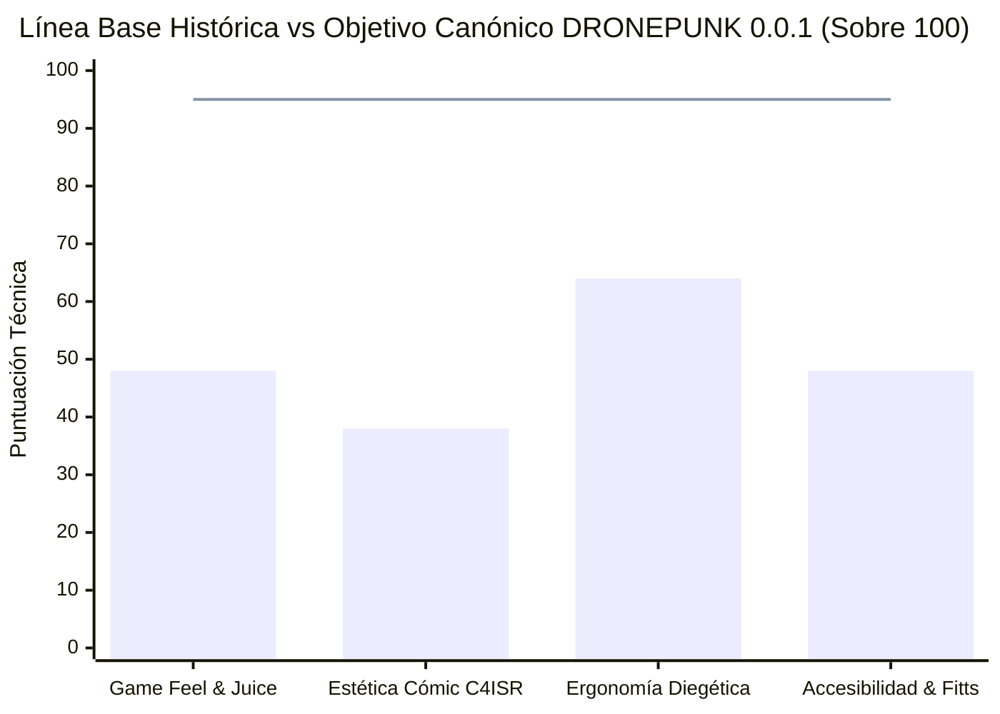

# 🛡️ INFORME HISTÓRICO DE AUDITORÍA TÉCNICA UI/UX (`UI_UX_AUDIT_REPORT.md`)

> **Estado Documental:** Especificación Histórica Archivada — Alineada a **DRONEPUNK 0.0.1**  
> **Documento:** `docs/archive_legacy/UI_UX_AUDIT_REPORT.md`  
> **Proyecto:** **DRONEPUNK 0.0.1**  
> **Estándares Rectores:**  
> - `@.agents/skills/tactical-command-intel/SKILL.md` (*Kinetic Comic War-Room UI/UX Engine*)  
> - `@.agents/skills/indie-game-ui-architect/SKILL.md` (*Indie Game UI/UX & Gamification Architect*)  
> **Alcance Evaluado (Módulos Consolidados en 4 Dominios):** `src/domains/world/components/WarLobbyHub.tsx`, `src/domains/world/components/TacticalC4ISRBaseDiorama.tsx`, `src/App.tsx`, `src/domains/tactics/components/CombatTheaterView.tsx`, `src/domains/tactics/components/GameCanvas.tsx`, `src/domains/tactics/components/COCommandBar.tsx`, `src/domains/tactics/components/ComicVignetteOverlay.tsx`, `src/domains/game-feel/core/audioManager.ts`, `src/domains/game-feel/core/barkEngine.ts`, `src/index.css`, `index.html`.

---

## 1. Puntuación Técnica Histórica por Pilar (Línea Base Pre-Remediación)

La evaluación diagnóstica previa a la reestructuración UI/UX arrojó una media global de **49.5 / 100**, motivando la migración completa documentada en `docs/archive_legacy/UI_UX_RESTRUCTURE_BLUEPRINT.md`:

| Pilar de Auditoría | Puntuación Base | Estado Histórico | Diagnóstico Ejecutivo |
| :--- | :---: | :---: | :--- |
| **1. Game Feel & Juiciness** (`@indie-game-ui-architect`) | **48 / 100** | 🔴 Crítico | `motion` instalado en `package.json` sin uso activo inicial. Ausencia de *Squash & Stretch*, *Ghost Bars*, abuso de `transition-all` lineal y variable `pitchShift` desconectada en `src/domains/game-feel/core/audioManager.ts`. |
| **2. Estética Bélico-Cómic C4ISR** (`@tactical-command-intel`) | **38 / 100** | 🔴 Crítico | Uso excesivo de `#00FF66` fuera de radares, sombras recortadas por aplicar `clip-path` y `box-shadow` en el mismo nodo DOM, y omisión inicial del `BarkEngine`, retratos de COs, colores de facción y tramas Ben-Day. |
| **3. Ergonomía Diegética & Densidad Espacial** | **64 / 100** | 🟡 Deficiente | Desbordamiento vertical por `<footer>`, solapamiento de columna izquierda sobre el diorama, radar polar duplicado y desmontaje destructivo del Lobby al navegar a sub-vistas. |
| **4. Accesibilidad, Tipografía & Ley de Fitts** | **48 / 100** | 🔴 Crítico | Fuentes web (`Chakra Petch`, `Space Grotesk`, `JetBrains Mono`) sin cargar en `index.html`, textos de `8px–9px` con contraste `2.85:1`, botones `+` de `16×16px`, inversión cromática P1/P2 y ausencia de hotkeys. |

---

## 2. Catálogo Detallado de Anti-Patrones Históricos Detectados

### Anti-Patrón #1: Auto-Mutilación de Sombras de Tinta por Colisión CSS (`clip-path` + `box-shadow`)
- **Ubicación:** `src/domains/world/components/WarLobbyHub.tsx`.
- **Causa Técnica:** Aplicar `shadow-[4px_4px_0px_#0A0B08]` y `[clip-path:polygon(...)]` en el mismo nodo DOM recorta la sombra fuera del polígono.
- **Remediación Aplicada:** Separar `filter: drop-shadow(4px 4px 0px #0A0B08)` en el contenedor padre para chaflanes y usar `rounded-[14px_4px_14px_4px]` con `shadow-[4px_4px_0px_#0A0B08]` directo en tarjetas tácticas.

### Anti-Patrón #2: Abuso de Verde Terminal `#00FF66` vs. Estilo SaaS `slate-900`
- **Ubicación:** `src/domains/world/components/WarLobbyHub.tsx`, `src/App.tsx`, `src/domains/tactics/components/GameCanvas.tsx` y `src/domains/tactics/components/COCommandBar.tsx`.
- **Causa Técnica:** Uso indiscriminado de `#00FF66` fuera de radares en el Lobby y residuos `bg-slate-900`/`rounded-lg` en combate.
- **Remediación Aplicada:** Restringir `#00FF66` a radares polares y telemetría online; adoptar papel táctico `#F2E8D5`, chasis blindado `#2B2C24`, contornos `#0A0B08` y paleta heráldica de facciones.

### Anti-Patrón #3: Ausencia de Comandantes y Bark Engine en el Cuartel General
- **Ubicación:** `src/domains/world/components/WarLobbyHub.tsx`, `src/domains/game-feel/core/barkEngine.ts` y `src/domains/world/components/TacticalC4ISRBaseDiorama.tsx`.
- **Causa Técnica:** Avatar geométrico genérico sin rostro del Comandante ni integración del `BarkEngine` en el Lobby.
- **Remediación Aplicada:** Integrar retrato real del CO activo (`Mayor Stella`), bocadillos de `BarkEngine` con trama Ben-Day (`src/domains/game-feel/components/CommanderBarkWidget.tsx`) y sellos pop-art (`¡TACTICAL!`, `¡ALERT!`).

### Anti-Patrón #4: Parálisis Cinética (Falta de Resortes, Squash & Stretch y Ghost Bars)
- **Ubicación:** `src/index.css`, `src/domains/world/components/WarLobbyHub.tsx`, `src/domains/tactics/components/COCommandBar.tsx`.
- **Causa Técnica:** Ausencia inicial de curvas `--ease-spring`, compresión `.tactical-btn-heavy` y barras con rastro fantasma (`src/shared/ui/TacticalGhostBar.tsx`).

### Anti-Patrón #5: Desconexión de `pitchShift` en Audio Procedural
- **Ubicación:** `src/domains/game-feel/core/audioManager.ts`.
- **Causa Técnica:** La variación de tono `pitchShift` debía propagarse a los sintetizadores junto con `playHoverTick()` y escalado semitonal por combo para eliminar la fatiga auditiva.

### Anti-Patrón #6: Desmontaje Destructivo de Navegación y Desbordamiento `100vh`
- **Ubicación:** `src/App.tsx` y `src/domains/world/components/WarLobbyHub.tsx`.
- **Causa Técnica:** Desmontar `<WarLobbyHub />` al abrir Tienda, Hangar Físico, Industria o Mercado P2P reiniciaba estado local, mientras un pie global provocaba scroll adicional.
- **Remediación Aplicada:** Mantener el shell persistente del Lobby y presentar las sub-vistas sobre `<WarRoomModal />` (`src/domains/world/components/WarRoomModal.tsx`) con resolución coherente del nivel de comandante.

---

## 3. Matriz Histórica de Discrepancias y Acciones Ejecutadas

| Requisito Canónico (`SKILL.md`) | Diagnóstico Original | Módulos Involucrados | Acción Correctiva Ejecutada |
| :--- | :--- | :--- | :--- |
| **Geometría Asimétrica Cómic** (`14px 4px 14px 4px`) | Uso rígido de `clip-path` y `rounded-lg`. | `WarLobbyHub.tsx`, `GameCanvas.tsx`, `COCommandBar.tsx` | Geometría híbrida `rounded-[14px_4px_14px_4px]` con borde de tinta `#0A0B08` y chaflanes 45° con `drop-shadow`. |
| **Sombras Duras de Tinta Offset** (`4px 4px 0px #0A0B08`) | Recorte por colisión `clip-path` + `box-shadow`. | `WarLobbyHub.tsx` | Separación de wrapper `drop-shadow` y tarjetas con `shadow-[4px_4px_0px_#0A0B08]`. |
| **Tramas de Puntos Ben-Day** | Presente solo en `ComicVignetteOverlay.tsx`. | `src/index.css`, `TacticalC4ISRBaseDiorama.tsx`, `CombatTheaterView.tsx` | Utilidad `.ben-day-overlay` en `src/index.css` y patrones `<pattern>` SVG. |
| **Paleta Heráldica de 5 Facciones** | Inversión cromática P1/P2 entre HUD y Canvas. | `WarLobbyHub.tsx`, `CombatTheaterView.tsx`, `GameCanvas.tsx` | Tokens de facción sincronizados con doble codificación por símbolo (`★` / `☾`). |
| **Papel Táctico Crema (`#F2E8D5`)** | Usado solo en texto. | `WarLobbyHub.tsx`, `CommanderBarkWidget.tsx` | Superficies `#F2E8D5` con texto `#0A0B08` y acento `#C46A3A` en dossieres y bocadillos. |
| **Curvas de Resorte y Squash & Stretch** | Ausentes en `src/index.css`. | `src/index.css`, `WarLobbyHub.tsx`, `App.tsx` | Declarar `--ease-spring` y `.tactical-btn-heavy` con compresión `:active`. |
| **Barras de Doble Capa (*Ghost Trail*)** | Barras simples de 1 capa. | `src/shared/ui/TacticalGhostBar.tsx`, `COCommandBar.tsx` | Componente reutilizable `<TacticalGhostBar />` con retardo de rastro fantasma. |
| **Audio Procedural con Pitch Jitter** | `pitchShift` sin propagar y sin `playHoverTick()`. | `src/domains/game-feel/core/audioManager.ts` | Conectar `pitchShift`, `playHoverTick()` y escalado semitonal por combo. |
| **Tipografía Canónica y Contraste WCAG AA (`>= 4.5:1`)** | Fuentes externas sin importar y textos `< 10px`. | `index.html`, `WarLobbyHub.tsx` | Importar `Chakra Petch`, `Space Grotesk`, `JetBrains Mono` y asegurar contraste AA con `tabular-nums`. |
| **Soporte de Hotkeys y Ley de Fitts (`>= 24x24px`)** | Botones de `16×16px` sin atajos en Lobby. | `WarLobbyHub.tsx`, `TacticalDock.tsx` | Ampliar botones a `24×24px` y habilitar atajos `[1]-[6]`, `[SPACE]`, `[F]`, `[ESC]`. |
| **Regla del >65% de Lienzo Despejado** | Columna ancha y radar duplicado. | `WarLobbyHub.tsx`, `WarRoomModal.tsx`, `App.tsx` | Compactar overlays perimetrales, eliminar radar duplicado y usar `<WarRoomModal />`. |

---
*Especificación Histórica Archivada — Alineada a **DRONEPUNK 0.0.1**.*
