# 📐 BLUEPRINT HISTÓRICO DE REESTRUCTURACIÓN UI/UX (`UI_UX_RESTRUCTURE_BLUEPRINT.md`)

> **Estado Documental:** Especificación Histórica Archivada — Alineada a **DRONEPUNK 0.0.1**  
> **Documento:** `docs/archive_legacy/UI_UX_RESTRUCTURE_BLUEPRINT.md`  
> **Proyecto / Versión:** **DRONEPUNK 0.0.1** (*Kinetic Comic War-Room Engine — Advance Wars meets Persona 5 / Hades + C4ISR*)  
> **Estado Histórico:** Consolidado e integrado en la arquitectura modular de 4 dominios  
> **Invariante Crítica:** **Cero modificaciones destructivas a la lógica de combate, motores matemáticos, contratos de Supabase ni firmas públicas de `WarLobbyHubProps`.**

---

## 1. Visión Arquitectónica: La Sala de Guerra Viva (Kinetic Comic War-Room)

La arquitectura transforma el Menú Principal (`src/domains/world/components/WarLobbyHub.tsx`) y su articulación con `src/App.tsx` y `src/domains/tactics/components/CombatTheaterView.tsx` en un **Centro de Mando C4ISR Vivo con Energía de Novela Gráfica Bélica**:

1. **Persistencia Espacial Total (Zero-Unmount HQ Shell):** El Cuartel General y su diorama isométrico permanecen montados al visitar la Tienda (`src/domains/economy/components/ShopCatalog.tsx`), Hangar Físico de 16 Chasis (`src/domains/economy/components/UnitHangarModal.tsx`), Complejo Industrial (`src/domains/economy/components/IndustrialComplexView.tsx`), Mercado P2P (`src/domains/economy/components/P2PMarketplaceView.tsx`), Alianza (`src/domains/world/components/ClanHeadquartersView.tsx`) o Archivos. En su lugar, la cámara hace enfoque cinético y despliega una **Terminal Táctica Diegética Superpuesta (`<WarRoomModal />`)** con desenfoque de cristal táctico (`backdrop-blur-md`).
2. **Presencia del Comandante en Guardia + Bark Engine en el Lobby:** El Cuartel General incorpora al Comandante activo (*Mayor Stella*, *Coronel Volkov*, *Andy*, *Gral. Vance*) con su estandarte de facción y bocadillo cómic reactivo de `src/domains/game-feel/core/barkEngine.ts` (tramas Ben-Day, papel táctico `#F2E8D5` y sellos pop-art rotados `¡TACTICAL!`, `¡ALERT!`, `¡RATATAT!`).
3. **Geometría Híbrida & Tinta Sólida (`45° Armor` + `14px/4px Comic Asymmetry`):** Se resuelve el recorte de sombras separando los chasis blindados achaflanados (con `drop-shadow(4px 4px 0px #0A0B08)`) de las tarjetas, medidores y bocadillos con curvatura asimétrica canónica (`rounded-[14px_4px_14px_4px]`, `border-2 border-[#0A0B08]`, `shadow-[4px_4px_0px_#0A0B08]`).

---

## 2. Sistema Unificado de Tokens Visuales (`src/index.css` & `index.html`)

### 2.1. Tipografía Expresiva y Tabular (`index.html`)
Tres familias tipográficas con personalidad militar y de novela gráfica:
- **Display / Titulares de Impacto y Sellos (`--font-display`):** `'Chakra Petch'` (700, 800, Italics) — Geometría mecanizada con cortes angulares ideales para encabezados C4ISR y onomatopeyas.
- **UI Táctica y Narrativa (`--font-sans`):** `'Space Grotesk'` (500, 700) — Lectura ultraclara para expedientes, fichas técnicas de chasis del hangar y bocadillos del Bark Engine.
- **Telemetría, Coordenadas y Odómetros (`--font-mono`):** `'JetBrains Mono'` (600, 800) con `font-variant-numeric: tabular-nums` obligatorio en todo contador o reloj.

### 2.2. Paleta Cromática Canónica (70-20-10 + Heráldica de Facciones)

| Categoría | Token CSS | Valor Hex | Uso Estricto en la Interfaz |
| :--- | :--- | :---: | :--- |
| **Núcleo Blindado (70%)** | `--color-bunker-void` | `#161712` | Foso de aplicación, sombras internas y bahía profunda. |
| | `--color-ink-black` | `#0A0B08` | Contornos de tinta cómic (`2px–3px`) y sombras duras offset (`4px 4px 0px`). |
| | `--color-armor-base` | `#2B2C24` | Chasis principal de paneles, tarjetas de unidad y consolas. |
| | `--color-military-olive` | `#46521F` | Cubiertas secundarias, módulos de apoyo y calzadas. |
| | `--color-metal-edge` | `#7B8A4A` | Biseles estructurales y bordes pasivos. |
| | `--color-olive-high` | `#A9B87A` | **Token accesible (WCAG AA `4.9:1` sobre `#2B2C24`)** para subtítulos y etiquetas. |
| **Papel Táctico & Datos (20%)** | `--color-data-cream` | `#F2E8D5` | Tipografía primaria, fondo de dossieres de misión, bocadillos cómic y *Ghost Bars*. |
| **Acentos de Combate (10%)** | `--color-rust-alert` | `#C46A3A` | CTA `¡ORDEN DE COMBATE!`, alertas DEFCON y daño balístico. |
| | `--color-amber-command` | `#F59E0B` | Recompensas de Oro, estrellas de rango/COP y botones de suministro. |
| | `--color-crt-radar` | `#00FF66` | **USO RESTRINGIDO:** Únicamente radares polares, barrido C4ISR y LED `ONLINE`. |
| **5 Facciones Heráldicas** | `--color-fac-orange` | `#E65100` / `#F59E0B` | **Orange Star / Iron Vanguard** (Stella, Andy, Max, Sami). |
| | `--color-fac-blue` | `#1D4ED8` / `#60A5FA` | **Blue Moon / Frost Legion** (Colin, Volkov, Grit). |
| | `--color-fac-green` | `#15803D` / `#4ADE80` | **Green Earth / Emerald Guard** (Eagle, Vance). |
| | `--color-fac-yellow` | `#D97706` / `#FDE047` | **Yellow Comet / Solar Shogunate** (Kanbei, Sonja). |
| | `--color-fac-black` | `#4C1D95` / `#EF4444` | **Black Hole / Shadow Syndicate** (Hawke, Sturm). |

### 2.3. Primitivas Geométricas y de Física (`src/index.css`)

```css
@import "tailwindcss";

:root {
  --ease-spring: cubic-bezier(0.34, 1.56, 0.64, 1);
  --ease-out-expo: cubic-bezier(0.22, 1, 0.36, 1);

  --color-bunker-void: #161712;
  --color-ink-black: #0A0B08;
  --color-armor-base: #2B2C24;
  --color-military-olive: #46521F;
  --color-metal-edge: #7B8A4A;
  --color-olive-high: #A9B87A;
  --color-rust-alert: #C46A3A;
  --color-data-cream: #F2E8D5;
  --color-crt-radar: #00FF66;
}

/* 1. Tarjeta Táctica Asimétrica con Tinta Sólida (Sin recorte de sombra) */
.tactical-comic-card {
  background-color: var(--color-armor-base);
  border: 2px solid var(--color-ink-black);
  outline: 1px solid rgba(123, 138, 74, 0.45);
  outline-offset: -3px;
  border-radius: 14px 4px 14px 4px;
  box-shadow: 4px 4px 0px var(--color-ink-black);
  transition: transform 0.2s var(--ease-spring), box-shadow 0.2s var(--ease-spring), border-color 0.15s ease;
}
.tactical-comic-card:hover {
  transform: translateY(-2px) scale(1.01);
  box-shadow: 6px 6px 0px var(--color-ink-black);
}

/* 2. Chasis Blindado Achaflanado a 45° con Drop-Shadow Externo */
.tactical-chamfer-wrap {
  filter: drop-shadow(4px 4px 0px #0A0B08);
}
.tactical-chamfer-box {
  clip-path: polygon(
    10px 0, calc(100% - 10px) 0,
    100% 10px, 100% calc(100% - 10px),
    calc(100% - 10px) 100%, 10px 100%,
    0 calc(100% - 10px), 0 10px
  );
}

/* 3. Botón de Mando Pesado 3D con Squash & Stretch (<16ms) */
.tactical-btn-heavy {
  background: linear-gradient(180deg, #df7b48 0%, #C46A3A 60%, #873612 100%);
  color: var(--color-data-cream);
  border: 2px solid var(--color-data-cream);
  border-bottom: 5px solid #5a1e05;
  border-radius: 14px 4px 14px 4px;
  box-shadow: 4px 4px 0px var(--color-ink-black);
  transition: transform 0.16s var(--ease-spring), border-bottom-width 0.06s ease, filter 0.12s ease;
  will-change: transform;
}
.tactical-btn-heavy:hover {
  transform: translateY(-2px) scale(1.03);
  filter: brightness(1.1);
}
.tactical-btn-heavy:active {
  transform: translateY(3px) scale(1.08, 0.90);
  border-bottom-width: 2px;
  box-shadow: 1px 1px 0px var(--color-ink-black);
}

/* 4. Trama de Puntos Ben-Day (Novela Gráfica) */
.ben-day-overlay {
  background-image: radial-gradient(rgba(123, 138, 74, 0.28) 18%, transparent 19%);
  background-size: 8px 8px;
}
.ben-day-cream {
  background-color: #F2E8D5;
  background-image: radial-gradient(rgba(196, 106, 58, 0.18) 18%, transparent 19%);
  background-size: 8px 8px;
}

/* 5. Barras de Doble Capa (Ghost Drain / Surge Trail) */
.bar-ghost-trail {
  transition: width 0.55s var(--ease-out-expo) 0.22s;
}
.bar-fill-spring {
  transition: width 0.15s var(--ease-spring);
}
```

---

## 3. Wireframes Esquemáticos por Zona (`100vh × 100vw` Puro, >70% Lienzo Despejado)

### 3.1. Distribución Espacial General y Las 4 Capas de Diegesis

```
+======================================================================================================+
| ZONA 1: TOP COMMAND HUD (h-14 / 56px fijo, z-30) — CAPA 4 NO-DIEGÉTICA                               |
| [Retrato CO + Rango + Ghost EXP Bar]  [⚡ C4ISR • Arena • 🏆2450 • Paridad T1]  [💰Oro|💎Gem|⚙️Acero|⚡En]|
+======================================================================================================+
|                                                                                                      |
|  ZONA 3A: INTEL & BARK (Izq, w-64)        ZONA 2: DIORAMA CENTRAL VIVO       ZONA 3B: OPS (Der, w-48)|
|  +-------------------------------+        (CAPA 1 DIEGÉTICA + CAPA 2)        +---------------------+ |
|  | 🗣️ VIÑETA GUARDIA CO (Bark)   |                                           | 🎡 ROTOR SUMINISTRO | |
|  | "Mayor Stella: ¡Silos al 90%!"|     [⚓ ASTILLERO NAVAL -> Industria]     | [¡GIRAR! - Ceremonia| |
|  | [Sello Pop-Art: ¡TACTICAL!]   |                                           +---------------------+ |
|  +-------------------------------+     [⚡ BÚNKER SILOS -> Cosecha +Acero]   | 📋 ÓRDENES DIARIAS  | |
|  | 📁 DOSSIER MISIÓN (Papel Crema|                                           | [1/3] ★ Logros  [R] | |
|  | "Sector Alpha: Baterías" [1/2]|     [🪖 HANGAR BLINDADO -> 16 Chasis]     +---------------------+ |
|  | [Ghost Progress] [Reclamar]   |                                                                   |
|  +-------------------------------+     [📡 RADAR POLAR 360° -> Mapa Frentes]                         |
|  | 🚨 DEFCON-1 + 🔥 RACHA 4x     |     (Único Radar Polar Diegético)                                 |
|  +-------------------------------+                                                                   |
|                                                                                                      |
|  (CAPA 3 META: Viñeta perimetral roja en DEFCON-1 / Scanlines CRT sutiles / Destello de Suministro)  |
+======================================================================================================+
| ZONA 4 & 5: TACTICAL DOCK + RADIO-NET + CTA TITÁN (h-20 / 80px fijo, z-30)                           |
| [1:Tienda][2:Industria][3:Hangar][4:Bolsa P2P][5:Alianza][6:Doctrina] | [📡 Radio-Net] | [⚔️¡COMBATE!]|
+======================================================================================================+
```

### 3.2. Detalle de las 5 Zonas Clave

1. **Zona 1: `CommandHUD` (`src/domains/world/components/CommandHUD.tsx`):**
   - **Expediente del Comandante (`[P]`):** Retrato del Comandante activo, borde heráldico de su facción (`Orange Star`), insignia de rango y **Barra de EXP de Doble Capa (`src/shared/ui/TacticalGhostBar.tsx`)**.
   - **Telemetría Central:** Tag del Clan, nombre de Arena, Trofeos, Escudos (`3/3`) y conmutador `TORNEO (PARIDAD TIER 1 0%)` vs `SECTORIAL (TIERS T1-T5, +2%/TIER)`.
   - **Banco de Recursos con Odómetro `motion`:** Contadores de `Fondos (G)`, `Gemas`, `Acero` y `Energía (EC)` con `tabular-nums` y botones `+` de `24×24px` (`w-6 h-6`) cumpliendo Ley de Fitts y WCAG AA.

2. **Zona 2: `TacticalC4ISRBaseDiorama` (`src/domains/world/components/TacticalC4ISRBaseDiorama.tsx`):**
   - **Entintado Cómic y Trama Ben-Day:** Contornos de tinta negra (`stroke="#0A0B08" strokeWidth="3"`), sombras proyectadas sólidas y patrón `<pattern>` Ben-Day.
   - **Siluetas *Advance Wars* de Alta Fidelidad:** Tanque Pesado en el Hangar, Helicóptero Artillado en el Helipuerto y Destructor en el Muelle Naval.
   - **4 Estaciones Diegéticas con Etiquetas Espaciales Cómic (`rounded-[14px_4px_14px_4px]`):**
     - `⚓ ASTILLERO // INDUSTRIA` (Muelle Naval — abre Complejo Industrial de 10 Parcelas).
     - `⚡ SILOS // +ACERO & ORO` (Búnker Generador — barra de capacidad y partículas al cosechar).
     - `🪖 HANGAR // 16 CHASIS FÍSICOS` (Bahía Blindada — abre Almacén Físico de 4 vanguardia + 12 reserva en `user_unit_hangar`).
     - `📡 RADAR C4ISR // FRENTES` (Torre de Radar Polar — abre Mapa WebGL Zero-Raster del Teatro Venezuela).
   - **Alarma de Búnker Conectada:** Activa la alerta `DEFCON-1` en la Capa Meta del viewport.

3. **Zona 3: `FactionBanner` (`src/domains/world/components/FactionBanner.tsx`):**
   - **Columna Izquierda (`w-64`, libera la Bahía y el Muelle Naval):**
     - **Tarjeta de Guardia del Comandante (Bark Reactivo):** Muestra al CO activo con bocadillo en papel táctico (`#F2E8D5`), trama Ben-Day y sello pop-art conectado a `src/domains/game-feel/core/barkEngine.ts`.
     - **Dossier de Misión de Campaña (Papel Crema `#F2E8D5`):** Contraste negro sobre crema, barra de progreso con *Ghost Trail* y reclamo con odómetro.
     - **Píldora Unificada DEFCON-1 + Racha de Victorias:** Alerta de incursión y accesos rápidos de operaciones.
   - **Columna Derecha (`w-48`, sin Radar duplicado):**
     - Acceso directo a `🎡 Rotor de Suministros`, `📋 Órdenes Diarias` y `🏆 Torneo`.

4. **Zona 4: `TacticalDock` (`src/domains/world/components/TacticalDock.tsx`) y Botón Titán `¡ORDEN DE COMBATE!`:**
   - **6 Estaciones con Hotkeys `[1]`–`[6]` y Estado Activo:** `[1] Tienda`, `[2] Industria`, `[3] Hangar`, `[4] Bolsa P2P`, `[5] Alianza`, `[6] Doctrina` + botón `[E] Editor`.
   - **Acceso Directo a Industria y Bolsa P2P:** `src/domains/economy/components/IndustrialComplexView.tsx` (10 parcelas) y `src/domains/economy/components/P2PMarketplaceView.tsx` (mercado 100% impulsado por jugadores, split 2% = 1% quema + 1% regalía de clan, collar VWAP ±25%, `strandedCargo`) permanecen accesibles desde el Dock.
   - **Botón Titán Dual (`¡ORDEN DE COMBATE! [SPACE]` + `⚡ BLITZ 1-CLIC [F]`):** Compresión física 3D `.tactical-btn-heavy` y lanzamiento directo de escaramuza en 1 clic.

5. **Zona 5: Barra Social `RADIO-NET // ENLACE TÁCTICO`:**
   - Tarjetas de aliados, avatares de facción, textos legibles (`>= 10px`, contraste AA) y transferencias con feedback sonoro y visual.

---

## 4. Especificación de Animaciones, Resortes, Audio Procedural y Ceremonia

### 4.1. Física de Animación con `motion` (`motion/react`)
1. **Apertura de `<WarRoomModal />` (`src/domains/world/components/WarRoomModal.tsx`):**
   - Entrada con resorte (`stiffness: 420, damping: 26`) y salida en `140ms` dentro de `<AnimatePresence>`.
2. **Odómetro de Recursos en `CommandHUD`:**
   - Rebote elástico en contadores al actualizar créditos, gemas, acero o energía (EC).
3. **Ceremonia de Revelación de 3 Tiempos en el Rotor de Suministros:**
   - Anticipación con `audioManager.playHoverTick()`, clímax con `audioManager.playComboAction(6)` y presentación visual por categoría con sello pop-art.

### 4.2. Mejoras al Motor de Audio (`src/domains/game-feel/core/audioManager.ts`)
1. **Conexión Real de `pitchShift` (`0.96 + Math.random() * 0.08`):** Propagado a los sintetizadores y `playCue()` para evitar fatiga acústica.
2. **Método `playHoverTick()`:** Pulso triangular de `20ms` (`680Hz -> 920Hz`) con variación aleatoria en `onMouseEnter`.
3. **Método `playComboAction(comboIndex)` / `playGoldTick(index)`:** Escalado semitonal ascendente para cosecha de silos, reclamo de misiones y ticks de recompensa.

### 4.3. Trauma Cuadrático (Screen Shake) y Coherencia en `src/domains/tactics/components/GameCanvas.tsx`
1. **Screen Shake Cuadrático (`traumaRef`):** Desplazamiento proporcional a `maxOffset * (trauma ** 2)` en impactos balísticos `1-100 HP`, explosiones y emboscadas, respetando `reduceMotion`.
2. **Sincronización Cromática y Daltonismo (P1 vs P2):** Coherencia cromática entre `GameCanvas.tsx` y `src/domains/tactics/components/CombatTheaterView.tsx` con doble codificación por símbolo (`★` P1 / `☾` P2).
3. **Chasis Blindado en Controles del Canvas:** Controles de cámara y audio con `#2B2C24`, borde `#0A0B08` y esquinas `rounded-[10px_3px_10px_3px]`.

---

## 5. Mapa Consolidado de Componentes en los 4 Dominios de DRONEPUNK 0.0.1

```mermaid
flowchart LR
    subgraph FaseA["1. Fundaciones & Audio (@domains/game-feel & @shared)"]
        IndexHTML["index.html (Fuentes Google)"]
        IndexCSS["src/index.css (Tokens C4ISR + Resortes)"]
        AudioMgr["src/domains/game-feel/core/audioManager.ts"]
    end

    subgraph FaseB["2. Componentes Modulares del Lobby (@domains/world & @shared)"]
        GhostBar["src/shared/ui/TacticalGhostBar.tsx"]
        CommandHUD["src/domains/world/components/CommandHUD.tsx"]
        Diorama["src/domains/world/components/TacticalC4ISRBaseDiorama.tsx"]
        FactionBanner["src/domains/world/components/FactionBanner.tsx"]
        TacticalDock["src/domains/world/components/TacticalDock.tsx"]
        WarRoomModal["src/domains/world/components/WarRoomModal.tsx"]
        WarLobbyHub["src/domains/world/components/WarLobbyHub.tsx"]
    end

    subgraph FaseC["3. Articulación Global & Combate (@domains/tactics)"]
        AppTSX["src/App.tsx (Overlay Shell sin desmontar Lobby)"]
        CombatView["src/domains/tactics/components/CombatTheaterView.tsx + COCommandBar.tsx"]
        Canvas["src/domains/tactics/components/GameCanvas.tsx"]
    end

    FaseA --> FaseB --> FaseC
```



### Mapa Real de Archivos en `DRONEPUNK 0.0.1`

| Archivo Real en Disco | Dominio | Responsabilidad e Invariantes |
| :--- | :---: | :--- |
| `index.html` | Raíz | Carga de fuentes `Chakra Petch`, `Space Grotesk` y `JetBrains Mono`. |
| `src/index.css` | Raíz | Variables CSS C4ISR, `.tactical-comic-card`, `.tactical-btn-heavy`, `.ben-day-overlay`, `.bar-ghost-trail`. |
| `src/domains/game-feel/core/audioManager.ts` | `@domains/game-feel` | `pitchShift` en `playSFX`/`playCue`, `playHoverTick()` y `playComboAction()`. |
| `src/shared/ui/TacticalGhostBar.tsx` | `@shared` | Barra de progreso de doble capa reutilizable (EXP, Energía, Misiones, Silos). |
| `src/domains/world/components/CommandHUD.tsx` | `@domains/world` | Barra superior C4ISR con retrato del CO, Ghost Bar de EXP, Arena/Trofeos y odómetros `motion`. |
| `src/domains/world/components/FactionBanner.tsx` | `@domains/world` | Viñeta reactiva del Comandante (`BarkEngine`), Dossier de Misión en papel crema `#F2E8D5` y DEFCON-1. |
| `src/domains/world/components/TacticalDock.tsx` | `@domains/world` | Dock inferior con hotkeys `[1]-[6]`, CTA `.tactical-btn-heavy` `[SPACE]`, Blitz 1-Clic `[F]` y `RADIO-NET`. |
| `src/domains/world/components/WarRoomModal.tsx` | `@domains/world` | Contenedor diegético animado con `motion` para los modales del Lobby y chasis superpuesto para sub-vistas. |
| `src/domains/world/components/TacticalC4ISRBaseDiorama.tsx` | `@domains/world` | Diorama SVG con entintado cómic `#0A0B08`, tramas Ben-Day, siluetas y alarma DEFCON. |
| `src/domains/world/components/WarLobbyHub.tsx` | `@domains/world` | Orquestador de submódulos del Lobby conservando `WarLobbyHubProps` y soporte de teclado (`1-6`, `Space`, `Escape`, `R`). |
| `src/App.tsx` | Raíz | Mantiene `<WarLobbyHub />` montado como shell persistente para sub-vistas dentro de chasis modal diegético C4ISR. |
| `src/domains/tactics/components/GameCanvas.tsx` & `src/domains/tactics/components/COCommandBar.tsx` | `@domains/tactics` | Coherencia P1/P2, trauma cuadrático (Screen Shake) y estética blindada `#2B2C24` con Ghost Bar en escala `1-100 HP`. |

---

## 6. Tríada C4ISR Canónica de DRONEPUNK 0.0.1

Para articular la experiencia macro-estratégica y territorial, el War Lobby integra tres componentes C4ISR clave:

### 6.1. Cabecera Dual de Recursos (`src/domains/world/components/DualResourceHeader.tsx`)
- Proyecta en la parte superior la telemetría dual dividida con estética militar:
  1. **Recursos Personales del Jugador:** Créditos de Combate ($G), Gemas de Mando, Acero Militar y Energía (EC) con tasa horaria ($+\text{EC/h}$).
  2. **Arcas Comunitarias de Facción:** Bóveda del Clan, multiplicadores económicos emanados del control de nodos estratégicos y capitales (`+5%` buff regional) y rango jerárquico dentro del clan.

### 6.2. Viñeta Táctica del Comandante (`src/domains/game-feel/components/CommanderBarkWidget.tsx`)
- Ubicada en la esquina inferior izquierda (`bottom-left`):
  - Retrato dinámico del Comandante activo con marco Ben-Day.
  - Bocadillo estilo cómic conectado a `src/domains/game-feel/core/barkEngine.ts`.
  - Reacciona a clics ciclando frases doctrinales, alertas DEFCON y respuestas hápticas (`src/domains/game-feel/core/hapticFeedback.ts`).

### 6.3. Gaveta Retráctil de Mando Paradox (`src/domains/world/components/ParadoxCommandDrawer.tsx`)
- Panel lateral retráctil en el extremo derecho:
  - **Pestaña de Frentes Territoriales:** Estado de las 24 entidades soberanas de Venezuela (`REG_VE_01`..`REG_VE_24`), `BUF_MARITIME_CARIBE`, 7 zonas buffer (`BUF_*`), asedios con Human Handshake de 120s y control TCP (`15,000 TCP` capitales, `10,000 TCP` estándar).
  - **Pestaña de Nodos Estratégicos:** Control soberano de los nodos clave del teatro y multiplicadores proyectados.
  - **Pestaña de Cola de Ensamblaje:** Tiempos de fabricación restantes para el Almacén Físico de 16 Chasis Militares (`user_unit_hangar`).
  - **Pestaña de Arsenal de Facción:** Tropas disponibles para despliegue en el frente territorial.

---
*Especificación Histórica Archivada — Alineada a **DRONEPUNK 0.0.1**.*
