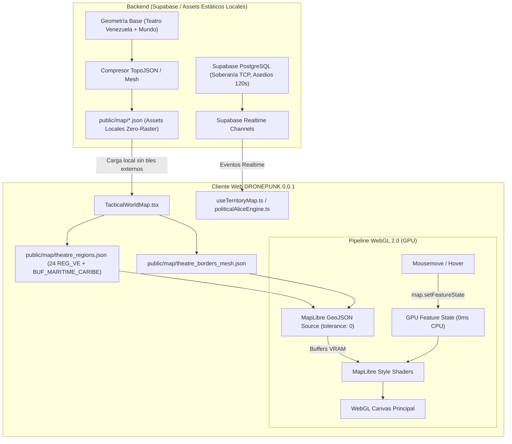

# Arquitectura Cartográfica Zero-Raster (Referencia WarEra)
## Análisis Forense de Rendimiento y Guía Histórica de Replicación para DRONEPUNK 0.0.1

> **Estado Documental:** Especificación Histórica Archivada — Alineada a **DRONEPUNK 0.0.1**  
> **Documento:** `docs/archive_legacy/WARERA_MAP_ARCHITECTURE_DEEP_DIVE.md`  
> **Implementación Resultante en Código:** `src/domains/world/components/TacticalWorldMap.tsx`, `src/domains/world/core/coordinates.ts`, `public/map/theatre_regions.json` y `public/map/theatre_borders_mesh.json`.

---

## 1. Resumen Ejecutivo: ¿Por qué el mapa WebGL Zero-Raster es ligero y fluido?

Los juegos web de estrategia militar o geopolítica tradicionales cometen con frecuencia dos errores críticos:
1. **Sobrecarga de Tiles Raster (PNG/JPG)**: Descargar cientos de imágenes cuadradas (`{z}/{x}/{y}.png`) mediante peticiones HTTP concurrentes cada vez que el usuario hace pan o zoom. Esto satura el ancho de banda, genera parpadeos y consume decenas de megabytes de RAM.
2. **Sobrecarga de DOM/SVG**: Renderizar miles de nodos `<path>` o `<svg>` en el árbol del navegador. Cuando hay cientos de regiones o municipios, cada evento de `mousemove` o cambio de color fuerza un *reflow* y *recalculation* de estilos en la CPU, derrumbando los FPS.

### La Fórmula Zero-Raster Estudiada:
La arquitectura de referencia **WebGL Vectorial Híbrida Zero-Raster** se basa en:
- **Cero peticiones de tiles raster:** No existe un servidor de tiles de fondo sirviendo imágenes PNG. El mapa completo se dibuja procedural y vectorialmente en la GPU.
- **Topología compacta con deduplicación de arcos (`topojson-client`):** Al deduplicar fronteras compartidas entre regiones vecinas, se evita repetir coordenadas y se reduce drásticamente el payload geométrico.
- **Motor WebGL Nativo (MapLibre GL JS v6):** Renderizado acelerado por hardware a 60 FPS continuos.
- **Interactividad en GPU sin re-renderizado (`feature-state`):** Al pasar el mouse sobre una región, **no se ejecuta ningún re-render de React** ni se muta el GeoJSON. Se envía una sola llamada `map.setFeatureState(..., { hover: true })`. El shader de WebGL actualiza el color instantáneamente en la tarjeta gráfica con sobrecarga de CPU mínima.
- **Control de Memoria JS e Inactividad:** Gestión eficiente de fuentes GeoJSON en VRAM y suspensión automática cuando la pestaña pierde foco o permanece inactiva.

---

## 2. Pila Tecnológica de Referencia Estudiada

| Capa | Tecnología / Módulo | Propósito |
| :--- | :--- | :--- |
| **Pipeline de Datos** | **TopoJSON Client (`topojson-client`)** | Convierte topologías compactas en mallas (*meshes*) y colecciones GeoJSON limpias sin aristas duplicadas. |
| **Motor Vectorial Base** | **MapLibre GL JS (WebGL 2.0)** | Dibuja polígonos de agua, continentes, regiones, estados, municipios y etiquetas SDF (*Signed Distance Field*). |
| **Capa Vectorial Local** | **GeoJSON / Mesh en `public/map/`** | Geometrías locales para el Teatro Venezuela (`theatre_regions.json`, `theatre_borders_mesh.json`, `theatre_roads.json`, `theatre_urban_roads.json`, `theatre_cities.json`, `zulia_municipalities.json`, `world_land.json`). |
| **Motor de Texturas Procedurales** | **Canvas / Shaders WebGL** | Genera patrones visuales para sectores en disputa o sin suministros. |
| **Estado Global y Datos** | **Supabase Realtime + Hooks de Dominio** | `src/domains/world/hooks/useTerritoryMap.ts` y `src/domains/world/hooks/useSiegeRealtime.ts`. |

---

## 3. Arquitectura del Flujo de Datos



---

## 4. Los 6 Secretos de Optimización Cartográfica

### Secreto 1: Deduplicación de Fronteras Compartidas (TopoJSON / Mesh Único)
En GeoJSON sin normalizar, cuando dos regiones comparten una frontera, esa secuencia de coordenadas se repite **dos veces** (una en el polígono de cada entidad).
- **Solución Aplicada en DRONEPUNK 0.0.1:** Las líneas compartidas se consolidan mediante el pipeline TopoJSON Bottom-Up (`scripts/verify-map-topology.mjs`) generando `public/map/theatre_regions.json` y `public/map/theatre_borders_mesh.json` con desfase `0.000 m`.
- **Ejemplo con `topojson-client`:**
  ```ts
  import { feature, mesh } from 'topojson-client';

  // 1. Polígonos de regiones para pintar y detectar selección
  const regionsGeoJson = feature(topology, topology.objects.regions);

  // 2. Malla unificada de fronteras (MultiLineString): líneas únicas sin duplicados
  const regionBordersMesh = mesh(topology, topology.objects.regions, (a, b) => a !== b);

  // 3. Costas exteriores
  const coastlinesMesh = mesh(topology, topology.objects.regions, (a, b) => a === b);
  ```

### Secreto 2: React NO toca el mapa en `mousemove` (`feature-state`)
Guardar `hoveredRegionId` en un `useState` de React y cambiar la prop `fillColor` del polígono destruye el rendimiento del árbol DOM en cada movimiento del mouse.

La arquitectura correcta delega el hover a **Feature State en la GPU**:
1. El estilo del Layer en MapLibre define la regla en el shader:
   ```json
   {
     "id": "regions-fill",
     "type": "fill",
     "source": "regions",
     "paint": {
       "fill-color": [
         "case",
         ["boolean", ["feature-state", "hover"], false],
         "rgba(255, 255, 255, 0.25)",
         ["get", "clanColor"]
       ],
       "fill-opacity": 0.85
     }
   }
   ```
2. El listener del mouse solo avisa a la GPU:
   ```ts
   let currentHoverId: string | null = null;

   map.on('mousemove', 'regions-fill', (e) => {
     if (e.features && e.features.length > 0) {
       const newId = String(e.features[0].id);
       if (currentHoverId !== newId) {
         if (currentHoverId) {
           map.setFeatureState({ source: 'regions', id: currentHoverId }, { hover: false });
         }
         currentHoverId = newId;
         map.setFeatureState({ source: 'regions', id: newId }, { hover: true });
         map.getCanvas().style.cursor = 'pointer';
       }
     }
   });

   map.on('mouseleave', 'regions-fill', () => {
     if (currentHoverId) {
       map.setFeatureState({ source: 'regions', id: currentHoverId }, { hover: false });
       currentHoverId = null;
       map.getCanvas().style.cursor = '';
     }
   });
   ```

### Secreto 3: Texturas de Patrones Inyectadas en la GPU (`fill-pattern`)
Cuando una región está bajo asedio o desabastecida, en lugar de dibujar cientos de líneas vectoriales adicionales, se genera un patrón de 16×16 píxeles una sola vez y se inyecta con `map.addImage('region-pattern-attacked', imageData, { pixelRatio: 2 })`.

### Secreto 4: Curvas Balísticas y Líneas Logísticas Vectoriales
Las rutas logísticas entre nodos, carreteras troncales (`public/map/theatre_roads.json`) y arterias urbanas (`public/map/theatre_urban_roads.json`) se proyectan directamente en capas vectoriales WebGL evitando recálculos SVG por frame.

### Secreto 5: Liberación de Referencias Pesadas en Heap de JavaScript
Una vez que MapLibre carga las fuentes vectoriales en VRAM, se evita retener copias duplicadas en el estado de React para mantener bajo el consumo de memoria en sesiones prolongadas.

### Secreto 6: Control de Inactividad y Frame Limiting
- **Throttling de Pixel Ratio**: En pantallas de alta densidad, acotar `pixelRatio` evita sobrecalentamiento en dispositivos móviles.
- **Suspensión de Contexto WebGL**: Cuando la pestaña pasa a segundo plano (`document.visibilityState === 'hidden'`) o tras inactividad prolongada, se pausa el loop de renderizado.

---

## 5. Blueprint Histórico Consolidado en DRONEPUNK 0.0.1

La adopción de este patrón en **DRONEPUNK 0.0.1** (con `maplibre-gl` en `package.json`) se completó en 4 pasos:

### Paso 1: Dependencias Vectoriales
```bash
npm install topojson-client topojson-server topojson-simplify
```

### Paso 2: Artefactos Cartográficos en `public/map/`
Generación y validación topológica de los archivos locales:
- `public/map/theatre_regions.json`
- `public/map/theatre_borders_mesh.json`
- `public/map/theatre_roads.json`
- `public/map/theatre_urban_roads.json`
- `public/map/theatre_cities.json`
- `public/map/zulia_municipalities.json`
- `public/map/world_land.json`

### Paso 3: Renderizador Canónico
Consolidado en `src/domains/world/components/TacticalWorldMap.tsx` junto con `src/domains/world/core/coordinates.ts` y `src/domains/world/core/tacticalBitmap.ts`.

### Paso 4: Capa de Sincronización en Tiempo Real con Supabase
En lugar de reconstruir el mapa completo, las mutaciones de soberanía (`15,000 TCP` en capitales, `10,000 TCP` en provincias estándar) y asedios (`120s` Human Handshake) fluyen mediante Supabase Realtime (`src/domains/world/hooks/useTerritoryMap.ts` y `src/domains/world/hooks/useSiegeRealtime.ts`), actualizando directamente los estados vectoriales en GPU.
